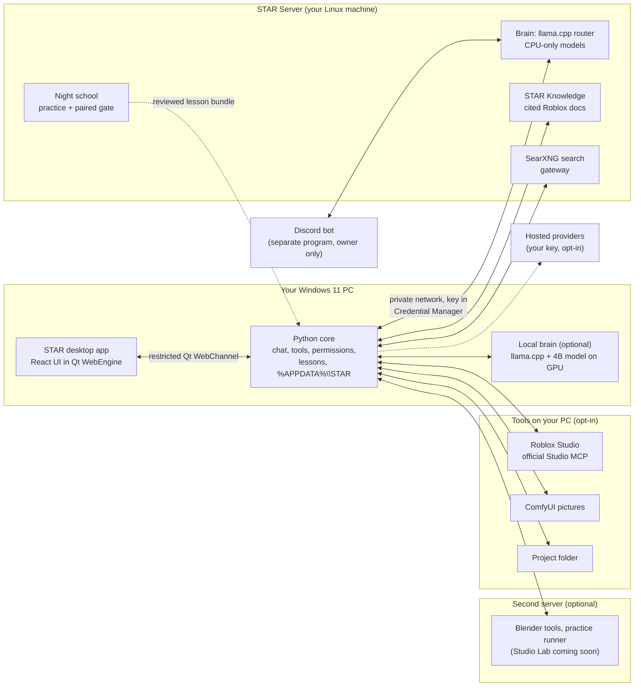

# STAR

**An AI that runs on machines you own.** STAR is a chat app for Windows 11. It talks to a model on your PC or on
your own Linux server, helps you build Roblox games, makes pictures, searches the web, and practises at night to get
better, with you deciding what it keeps.

[Public downloads (migration pending)](https://github.com/oncoursemail/Star-AI/releases) ·
[Public website (after Pages setup)](https://oncoursemail.github.io/Star-AI/) ·
[v1.0 release notes](docs/release/v1.0/RELEASE_NOTES.md) ·
[Report a problem](https://github.com/oncoursemail/Star-AI/issues)


<sub>The app's browser preview with its sample conversation (no model running). Captured by
`frontend/scripts/capture-site-media.mjs`.</sub>

> **Private/public migration (October 2026):** This is STAR's **private source repository**.
> Historic `v1.0.0` packages remain attached to this private repository's previous releases
> and are **not yet available from the new public download channel**.
> STAR checks [public Star-AI Releases](https://github.com/oncoursemail/Star-AI/releases), which
> currently has no installer. The next approved version must go through the
> [private/public release procedure](docs/PRIVATE_PUBLIC_RELEASE_MIGRATION.md), including
> a new version tag, controlled private CI, restricted public publisher token and
> anonymous Windows download verification. PRs and CI artifacts are not public downloads.

## What STAR is

- **A chat app first.** Saved chats, search, rename, delete with undo, one "+" for files, pictures, web search and
  your screen. It feels like the chat apps you already know.
- **Your hardware, your data.** The model runs on your PC or on your own STAR Server. Chats, settings and lessons stay
  in `%APPDATA%\STAR` on your disk. There is no account and no sign-in.
- **Off until you say so.** Anything that can reach your files, your screen, Roblox Studio or the internet is off or
  asks first. STAR never falls back to a hosted model on its own.
- **It practises, and you review.** While your server is idle, STAR practises Roblox tasks, checks its answers and
  proposes lessons. A statistical gate drops most of them; the rest are shown to you, and you can undo any of them.

## Features and their status

**Available** = on when you install. **Opt-in** = you switch it on or set it up. **Coming soon** = an open pull
request, not in v1.0.

| Area | Feature | Status |
|---|---|---|
| Chat | Saved chats grouped by day, search, rename, delete with 6 seconds to undo; answers keep streaming when you switch chats | Available |
| Chat | **Look at my screen**: asks every time, takes one screenshot you can remove before sending | Available |
| Chat | **Create image** in the same box (needs a picture engine, ComfyUI, on this PC or your server) | Available |
| Chat | **Web search with sources** through the self-hosted SearXNG on your STAR Server (no paid key) or your own Brave/Tavily key | Opt-in |
| Chat | Knows the current date and time on every turn; a clock tool for time zones and date maths | Available |
| Roblox | Answers that cite the official Roblox and Luau documentation (STAR Knowledge on your server) | Available |
| Roblox | Map and blockout plans (offline dry run) | Available |
| Roblox | Luau checkers: full API dump name check, StyLua, official Luau analyzer, server/client trust checks | Opt-in |
| Roblox | Roblox Studio through the official Studio MCP: read-only inspection first, editing behind a separate switch | Opt-in |
| Roblox | Live create.roblox.com documentation search | Opt-in |
| Roblox | **Studio Lab**: build in a test place, playtest, look and fix, several Studios in parallel | Coming soon |
| Design | Style database (88 UI styles, 192 palettes, 74 font pairings, 119 UX rules) and a DESIGN.md checker with WCAG contrast | Available |
| 3D | Blender tools on a second server (two switches, both off) | Opt-in |
| 3D | STAR driving Blender on a server end to end; the first models (a dragon among them) are first attempts | Coming soon |
| 3D | Architecture planning prototype and Blender building kit (source checkout only, `STAR_ARCHITECTURE_TOOLS=1`; [guide](docs/STAR_ARCHITECTURE_BLENDER_RESEARCH.md)) | Opt-in |
| Brains | This PC: a 4B model on a Vulkan graphics card (about 8 GB of video memory), downloaded and checked in one step | Available |
| Brains | STAR Server: your own Linux server runs larger open models on its processor, no graphics card needed | Opt-in |
| Brains | Hosted providers (Groq, OpenRouter, Gemini, Cerebras) with your own key, never a silent fallback | Opt-in |
| Discord | Owner-only bot (a separate program): DM chat, `/ask`, `/image`, `/status`, `/screen` (off by default, asks each time) | Opt-in |
| Learning | Night school, 300 practice tasks, paired statistical gate, "What STAR learned this week" with Undo, corrections that become tests | Available (server side) |
| Voice | A warmer "Star" voice, read-aloud and push-to-talk calls (basic optional voice calls exist since v0.9.0) | Coming soon |

The full list, including every switch that is off by default, is in the
[v1.0 release notes](docs/release/v1.0/RELEASE_NOTES.md).

## Install

1. Once the first verified public stable release is available, download `STAR-Setup-vX.Y.Z.exe` from [Public GitHub Releases](https://github.com/oncoursemail/Star-AI/releases)
   (or the portable `STAR-Genesis-Windows-x64.zip`). No public installer is available until then.
2. Optional but recommended: compare the file with `SHA256SUMS.txt` from the same release:
   `Get-FileHash .\STAR-Setup-v1.0.0.exe -Algorithm SHA256`. The installer is not code-signed, so Windows may show a
   publisher warning.
3. Run Setup. The default per-user install needs no administrator rights. If your current copy was installed for
   all users, Windows asks for administrator approval on every upgrade; STAR says so before Setup starts.
4. Upgrading keeps `%APPDATA%\STAR` (chats, settings, lessons, downloaded models). Back that folder up first anyway.

STAR checks the separate **public** GitHub Releases repository anonymously for updates, with exact size and SHA-256 checks. It never needs this private source repository.

## Requirements

| | |
|---|---|
| System | Windows 11, 64-bit. Windows 10 is untested. |
| Model on this PC | A Vulkan graphics card with about 8 GB of video memory, and 4.3 GB free for the model download. |
| Or a STAR Server (optional) | Your own Linux machine on your network with plenty of memory. No graphics card needed. Its key is kept in Windows Credential Manager. Server setup files: [`server/`](server/). |
| Account | None. No sign-in, and no API key for a model you run yourself. |

## Quick start

1. Choose where the model runs. **This PC:** open **More → Model** and press **Download and start**. STAR fetches the engine and model, checks every file
   and asks the model for a test reply. **STAR Server:** in **Settings → Model & provider**, choose STAR Server, enter
   its address and key, and press **Test server**.
2. Start a chat. Use **+** to attach a file, create an image, search the web or show STAR your screen.
3. Optional: **Tools → Roblox Studio** to connect an unpublished test place (read-only first).

More detail: [Getting started](docs/GETTING_STARTED.md) and [Start here on Windows 11](START_HERE_WINDOWS11.md).

## Honest numbers

The same automated Roblox evaluation, run on v0.9.0 and on the v1.0.0 release code (STAR Server, model star-fast,
auto mode, skill packs off, one run per task, October 2026):

| Suite | v0.9.0 | v1.0.0 |
|---|---|---|
| Roblox scripting, development set | 13 / 34 | 16 / 34 |
| Creation tasks | 11 / 23 | 10 / 23 |
| Blind holdout, never used for tuning | 8 / 24 | 9 / 24 |

**Answer quality is about the same as v0.9.0.** A paired test on the development set calls the difference
inconclusive. A single run varies: earlier runs of the same development set scored 16 / 34 and 18 / 34 (range
13–18 / 34 across dated runs). The 16 Roblox v2 tasks that need Studio or manual assessment are not included. These
are automated checks, **not a game-quality score** and not proof that a game works. What v1.0 adds is new abilities
and the learning machinery, not a smarter model.

## Architecture



| Part | Where |
|---|---|
| Desktop UI and the public website | [`frontend/`](frontend/) (React 19, TypeScript, Vite) |
| Windows host and bridge allowlist | [`star/react_shell.py`](star/react_shell.py), [`star_desktop.py`](star_desktop.py) |
| Chat, tools and routing | [`star/agent.py`](star/agent.py), [`star/desktop_core.py`](star/desktop_core.py), [`star/providers.py`](star/providers.py) |
| Local brain setup | [`star/brain_setup.py`](star/brain_setup.py), [`star/local_runtime.py`](star/local_runtime.py) |
| Lessons, corrections, weekly review | [`star/lessons.py`](star/lessons.py), [`star/learned_week.py`](star/learned_week.py) |
| Server brain, knowledge, search, night school | [`server/`](server/) |
| Discord bot | [`star/discord_bot/`](star/discord_bot/) |
| Installer and release builds | [`installer/STAR.iss`](installer/STAR.iss), [`.github/workflows/windows-desktop.yml`](.github/workflows/windows-desktop.yml) |

More: [docs/ARCHITECTURE.md](docs/ARCHITECTURE.md).

## How STAR learns

1. **Practise.** While the STAR Server is idle, night school works through 300 practice tasks, each with a runnable
   check.
2. **Check.** Answers are scored by the same scorer the evaluation uses.
3. **Propose.** A repeated mistake becomes a lesson: plain text with its evidence attached.
4. **Gate.** A paired statistical test on held-out tasks. A lesson is kept only if it wins; an inconclusive result
   means no. STAR cannot edit its own evaluations, graders or gate.
5. **You decide.** "What STAR learned this week" puts a kept lesson on a 14-day trial with **Undo**, **Restore** and
   **Keep for good**.

Your corrections join the loop: mark an answer *Not helpful* and say why (in the app, or `wrong: ...` on Discord),
and you can turn it into a regression test. The model's weights never change in this loop. **The lesson file bundled
with v1.0 is empty**, so night school has not changed v1.0's answers yet; server lessons arrive as candidates you
review. Details: [docs/SELF_LEARNING_LOOP.md](docs/SELF_LEARNING_LOOP.md).

## Development setup

Needs Node.js 22 or newer and Python 3.11 (64-bit). From the repository root, in PowerShell:

```powershell
# Frontend: type check, tests, production build
cd frontend
npm ci
npm test
npm run build
cd ..

# Python: desktop app and tests
py -3.11 -m venv .venv
.\.venv\Scripts\python.exe -m pip install -r requirements-desktop.txt -r requirements-dev.txt
.\.venv\Scripts\python.exe -m pytest -q
.\.venv\Scripts\python.exe star_desktop.py
```

- `npm run dev` (in `frontend/`) serves the website. Add `?preview=1` for a read-only preview of the desktop
  interface; it cannot reach local files or a model.
- Website screenshots of the app: `npm run build`, then
  `node scripts/capture-site-media.mjs --tools <folder with playwright-core and sharp>`.
- Windows packaging: `scripts/build_windows.ps1`. `STAR.exe --doctor` checks the packaged backend.

## Project layout

| Folder | What is in it |
|---|---|
| `frontend/` | Desktop UI and public website (one Vite project; the site deploys to GitHub Pages from `main`) |
| `star/` | Python core: chat, tools, providers, Roblox, lessons, Discord bot, updater |
| `server/` | STAR Server: brain config, knowledge service, SearXNG gateway, night school, training, workbench |
| `evals/` | Evaluation suites (development, creation, blind holdout) and results |
| `tests/` | Python tests |
| `installer/`, `scripts/` | Windows installer and build/utility scripts |
| `examples/` | Roblox templates, test places, Blender recipes |
| `docs/` | Design notes, research, release notes and guides |
| `site/` | Legacy static fallback page |

## Privacy and safety

- No account, no telemetry, no analytics. The website sets no cookies.
- Chats, settings, lessons and models stay in `%APPDATA%\STAR`. Setup and updates keep that folder.
- Keys (STAR Server, hosted providers, Roblox Open Cloud, Discord) live in Windows Credential Manager or a local key
  file, never in chats, logs or the repository.
- Screen capture happens only after you press **Take screenshot**, once per press. On Discord, `/screen` is off by
  default and asks each time.
- Roblox Studio starts read-only. Editing a test place needs a separate switch; STAR does not publish games.
- STAR does not retrain its weights or merge code it wrote itself. Lessons are text you can read and remove.
- More: [Security and autonomy](docs/SECURITY_AND_AUTONOMY.md).

## Changelog

- [v1.0 release notes](docs/release/v1.0/RELEASE_NOTES.md): what is new, what is off by default, what was measured
  and what was not tested.
- [v0.9.0 release notes](docs/STAR_V090_RELEASE_NOTES.md), [all releases](https://github.com/oncoursemail/Star-AI/releases),
  [commit history](https://github.com/oncoursemail/Star-AI/commits/main).
- [Website and release handoff checklist](docs/WEBSITE_RELEASE_CHECKLIST.md).

## Contributing

Issues and ideas are welcome on [GitHub Issues](https://github.com/oncoursemail/Star-AI/issues). Attach a screenshot
of the error and leave out keys, passwords and private addresses. Pull requests go to the `star/next` branch, need
green tests (`npm test` and `npm run build` in `frontend/`, `pytest -q` for Python), and must not add private IP
addresses, host names, user names or keys. The [repository guide](docs/REPOSITORY_GUIDE.md) explains how the code is
organised.

## License

The repository has **no licence file** yet. The source is public to read, but a public source tree does not by itself
grant an open-source licence. Third-party data bundled with STAR keeps its own licence (for example the design
database under `star/data/design/`, MIT).
