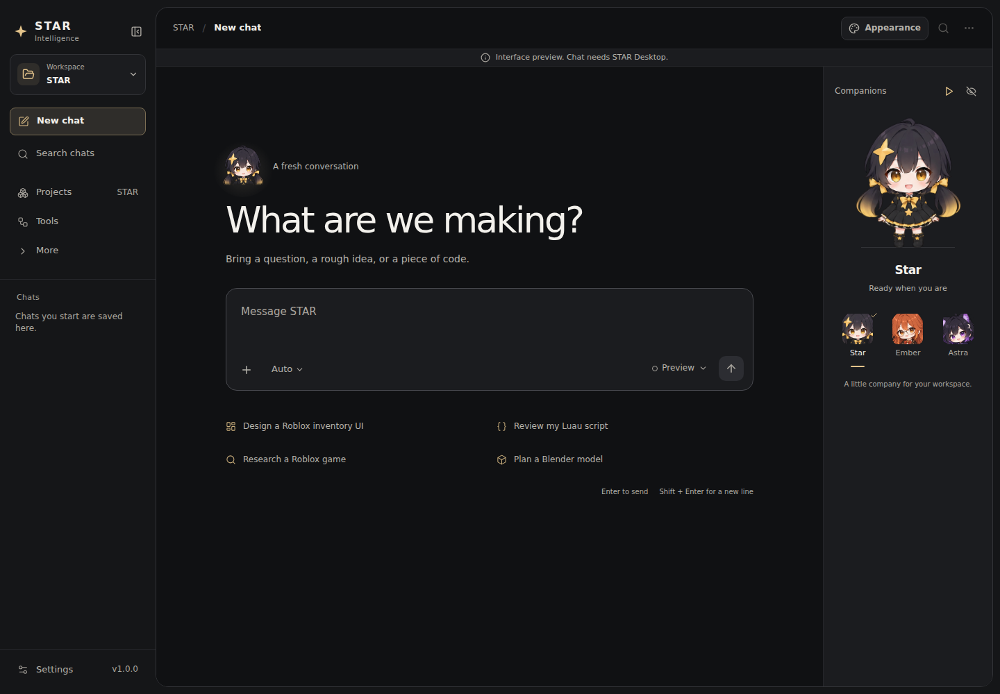
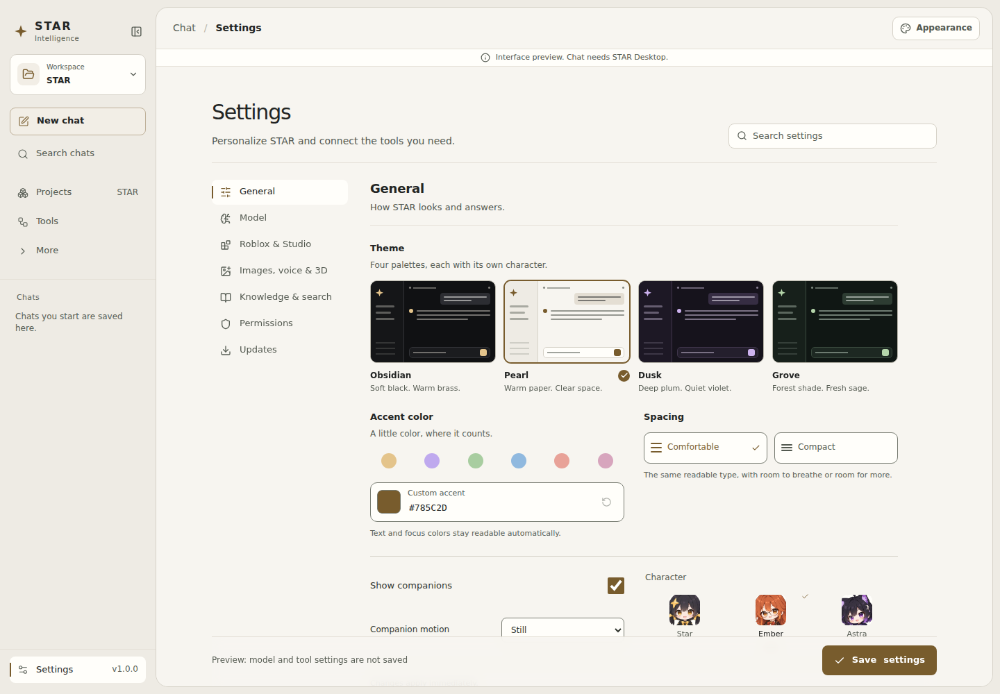

# Star Studio UI: themes, original companions, and a focused workspace

**Research date:** October 19, 2026. **Status:** implemented review candidate, with browser and regression evidence recorded below. Packaged Windows verification and the owner's aesthetic approval remain pending. This is not a release announcement or evidence of a faster model.

## Decision

Give Star a complete, customizable appearance and an original companion cast within the working interface. The conversation and its output remain the main surface. Characters occupy reserved space, and their expressions reflect coarse application state. Appearance, character selection, density, and motion should be discoverable and reversible.

The owner's latest request explicitly rejects the current appearance and asks for substantially better design, custom themes, and the cute characters discussed previously. This candidate therefore goes beyond recoloring the previous research panel. It keeps the existing chat, project, tool, accessibility, and cancellation behavior while changing the presentation around them.

The design inference is that Star's character identity, spatial composition, typography, and interaction consistency should make it recognizable. No source establishes that a particular palette is objectively beautiful, that an automated score proves originality, or that a visual refresh improves model intelligence.

## 1. Recovered intent and the actual starting point

The earlier companion request is recorded in [Living AI Companions](../STAR_CLIPS_LIVING_COMPANIONS_RESEARCH_20261015.md). It describes orange-haired, bespectacled “Opus 5.5” and purple-haired, cat-eared “ASTRA 6” fan references, with playful character interaction and optional animal forms. They were reference material, not official provider assets. The same document proposes independently assignable visual skins, including copper scholarly and navy/violet celestial directions. Its `companionDirector.ts` is explicitly a pure future contract; it did not render an additional cast.

The existing [Star character specification](../mascot/CHARACTER.md) establishes the approved identity: indigo-black hair, low twin tails with gold tips, a four-point gold clip, amber eyes, black/gold dress, and mitten hands. The candidate retains that identity and its shipped face/pose artwork. New Ember and Astra artwork belongs to a coherent original cast; selecting either does not activate a provider, add a worker, or change a model.

Inspection of the inherited frontend found these concrete issues and useful foundations:

| Existing implementation | Finding | Targeted response |
| --- | --- | --- |
| `Desktop.tsx` CSS imports | Eight successive layers: `tokens.css`, `stellar-ui.css`, `chat.css`, `learning.css`, `redesign.css`, `resilience.css`, `polish.css`, `start-canvas.css`. | Use a canonical appearance contract, then inspect the computed result across real screens. A stylesheet import is not proof that hard-coded older colors disappeared. |
| `tokens.css` | Semantic surface, text, accent, status, spacing, type, and motion tokens already exist, including legacy aliases. They are scoped to `.shell` and portaled `.star-layer` elements. | Extend this contract for the theme system; apply the selected appearance to dialogs and menus as well as the shell. |
| `StarPet.tsx` / `StarPet.css` | Approved expressions and real activity mapping exist, but the character is an off-by-default fixed 100 × 112 overlay with corner placement. | Provide a reserved companion area and discoverable controls. Preserve an explicit saved Hide choice. |
| `SettingsPage.tsx` | “Show Star” exists, but there is no complete custom-theme experience in the inspected baseline. | Present themes, custom accent, density, and companion choices together as appearance preferences. |
| `StarFace.tsx` | The expression effect changes a state variable included in its own dependency list, invalidating its removal timer. | Correct the lifecycle and verify rapid expression changes, reduced motion, and unmounting. |
| `companionDirector.ts` | It represents possible future routed characters and decorative scenes; it is not a working multi-agent animation system. | Keep the new cosmetic cast clearly separate from routing and verified work events. |

### What this candidate supersedes

The single-dark-palette restriction in [OLED v0.6](../STAR_DESIGN_SYSTEM.md) and the fixed appearance aspects of [Quiet Chat](../STAR_UNIFIED_DESKTOP_REDESIGN.md) give way to complete selectable themes. Quiet Chat's conversation-first hierarchy, readable message column, progressively disclosed tools, and explicit media controls remain useful.

The presentation choices in [Creator Workbench](STAR_CRAFT_WORKBENCH_20261015.md) and [Professional Workbench](STAR_PRO_WORKBENCH_20261015.md) are earlier iterations, not proof of current owner approval. The Studio candidate replaces their home composition and surface styling through scoped components and overrides. It does not mass-delete old CSS or rewrite unrelated pages merely to reduce the file count.

The [AETHER blueprint](../research/STAR_AETHER_DESIGN_COMMERCE_BLUEPRINT.md) is historical research, not a requirement to add a permanent inspector to every chat. The new request authorizes a concrete implementation and reviewable screenshots. This document does not grant deployment authority or alter evaluation, release, authentication, or policy gates.

### Implemented surfaces

`StudioChrome.tsx` and `studio.css` now provide the project switcher, quieter navigation, aligned welcome and composer, and a reserved companion region. Starter actions are readable rows with meaningful icons; the decorative boxes around each starter were removed during screenshot review. Existing Lucide controls and Star's own mark retain their established roles rather than implying every icon was newly drawn.

`appearance.ts`, `useAppearance.ts`, `AppearancePanel.tsx`, and `appearance.css` implement the four semantic themes, bounded custom accent, comfortable/compact spacing, persistence, reset, and a portaled appearance drawer. Wide General Settings uses four theme previews in one row; narrower Settings and the drawer keep an appropriately denser arrangement. The final wide thumbnails are approximately 181 × 119 CSS pixels, replacing the earlier 373 × 245 previews that pushed ordinary preferences too far down the page.

`CompanionShelf.tsx`, `companion-catalog.ts`, and `companion-shelf.css` implement selection, hiding, motion controls, state labels, and a responsive reserved area for Star, Ember, and Astra. The desktop hidden state contracts to a 56px reopening rail. A narrow screen starts with a compact disclosure instead of an always-expanded character. The old “Show Star” setting remains an explicitly described, extra floating corner companion; it is separate from the new shelf and is off by default.

## 2. Design quality: critique the result, not a list of forbidden fashions

Anthropic's current frontend-design guidance emphasizes subject-specific decisions, coherent typography, meaningful structure, limited unsolicited motion, and screenshot-based critique. It also observes that newer cream/serif/terracotta and near-black/acid-accent combinations can become interchangeable defaults just as older gradient card layouts did. The useful lesson is deliberate composition, not replacing one fashionable template with another. [S1]

The actual [UI UX Pro Max upstream][s2] and [Anti-AI-UI repository][s3] were inspected. Both provide useful review material and identify MIT licensing. Their examples, catalog sizes, and marketing descriptions are not independent usability evidence. Star already contains a `star/data/design/ui-ux-pro-max` dataset; this pass does not require installing another design framework or importing duplicated rule collections.

**Applied design inference:** retain familiar navigation and controls, establish a clear reading order, and spend the strongest visual personality on the original cast. Use actual project names, task descriptions, and application states. Remove repetitive headings, duplicate actions, decorative counters, and framing that adds no information. A border, serif, gradient, or rounded corner is acceptable when it serves this particular product.

Linear's March 2026 account of its refresh is directly relevant: accumulated individually reasonable changes can crowd a product, and navigation should recede once the user reaches the work. Its in-product color tools also show the value of inspecting a palette against the real interface. These are design references, not an instruction to reproduce Linear. [S4]

## 3. A canonical theme and density system

The candidate implements four complete presets. The descriptions below are art direction; exact colors and achieved contrast come from the implementation and the scoped measurements recorded in section 6.

| Preset | Intended character | Invariant |
| --- | --- | --- |
| **Obsidian** | Neutral dark workspace with restrained warm accents. | Preserve clear separation between canvas, controls, and elevated menus. |
| **Pearl** | Light workspace with clear ink-colored text and a quiet accent. | Treat light mode as a full design, including code, dialogs, disabled controls, and errors. |
| **Dusk** | Muted violet-toned environment suited to the celestial character direction. | Keep violet from becoming the only means of identifying selected or active state. |
| **Grove** | Subdued green environment with balanced neutral reading surfaces. | Keep decorative green distinct from success semantics. |

Custom accent should derive or select a complete set of accent roles: solid background, foreground-on-accent, hover, selected wash, text/link, and focus. Validate the input and persist a bounded appearance preference, not arbitrary CSS or executable theme code. Provide a straightforward reset. A displayed swatch alone does not establish that all dependent states are readable.

Radix documents separate scale roles for backgrounds, component states, borders, strong accents, and text. Its custom palette tool provides a useful reference for generating related colors, including sRGB fallbacks. Star can use the principle without adding a component library. Radix's stated APCA properties are not a substitute for checking the WCAG contrast requirements used in this project. [S5, S6]

Normal text should meet 4.5:1 and large text 3:1 against its actual background; meaningful icons, focus indicators, and control states generally need 3:1 against adjacent colors. Include placeholder, tooltip, selected, hovered, and error text. Decorative separators need not all be conspicuous boxes. Measurements should use computed colors, including composited transparency, without rounding a failing value upward. [S7, S8]

Density changes spacing and the amount of material visible, not the basic reading order. Comfortable and compact modes should preserve text legibility, focus visibility, and accessible targets. WCAG 2.2's minimum target rule allows either 24 × 24 CSS pixels or its specified alternatives; “compact” is not permission to make adjacent controls difficult to activate. [S9]

Theme and density preferences must also reach portaled layers. Keep the desktop's font loading local, use the existing type roles, and verify the result at narrow widths and increased text/display scale. No remote font request is necessary for this candidate.

## 4. Star, Ember, and Astra: an original cast with honest behavior

| Character | Direction | Operational meaning |
| --- | --- | --- |
| **Star** | Preserve the approved dark hair, gold details, amber eyes, and recognizable silhouette. | The established application companion. |
| **Ember** | Original warm copper character informed by the earlier scholarly reference. | A selectable cosmetic companion; no claim of Anthropic affiliation or a separate running worker. |
| **Astra** | Original purple/celestial character informed by the earlier cat-eared reference. | A selectable cosmetic companion; no claim of OpenAI affiliation or a separate running worker. |

The new transparent Ember and Astra assets have been generated and visually inspected in the actual interface. The [art provenance record](STAR_COMPANION_ART_20261019.json) records the tool, prompts, approved Star style reference, dimensions, hashes, and original-asset preservation. Star's existing approved artwork remains intact. A framing correction made its visible body scale more consistent with the new cast. This is implementation-team visual inspection; the owner has not yet accepted the aesthetic result.

Duolingo's account of developing its cast supports shared shape language, distinctive characters, iteration, and integration into the application's meaningful moments. It does not show that adding a mascot improves an AI's reasoning. The inference for Star is to place the cast within ordinary work while keeping their design coherent. [S10]

The companion area should reserve space in layout rather than float across editable content. A small chooser can select the visible companion, with a larger presentation where the face and silhouette remain legible. Hiding it should reclaim its space. Do not shrink a full drawing into an unreadable navigation icon: the established Star specification calls for a dedicated icon below 64px full-character height.

Expressions consume coarse states such as ready, input, working, writing, stopped, and error. New companions may reflect the same application state without becoming agents. A successful finish must follow the actual terminal event. A decorative wave is not evidence that research, testing, or a file write occurred. Do not fabricate conversations among idle characters or associate them with providers without real routing.

Keep dismissal, motion control, and selection easy to reach. Microsoft HAX guidance supports context-sensitive interruption, efficient invocation/dismissal/correction, clear system capabilities, and global controls. Applied here, a companion may open relevant work details when selected, but should not interrupt each streamed token or obscure an actionable error. [S11]

## 5. Repair the lifecycle before adding animation

### Confirmed source defect: expression crossfade

In the inspected baseline `StarFace.tsx`, an effect depended on `[mood, shown, reduced]`. A mood change scheduled a 240ms timer to clear `leaving`, then called `setShown(mood)`. The resulting `shown` change caused React to run the cleanup, cancelling that timer. The next effect returned immediately because `mood === shown`.

**Baseline consequence:** the outgoing image could remain mounted after its visual fade, and the `!leaving` condition could keep blinking disabled.

The implemented fix uses one frame state and a previous-mood ref, with the transition effect depending on `[mood, still]`. Updating the displayed frame no longer cancels its own removal timer. Reduced motion and hidden-document state settle the frame; cleanup releases the timer. Six focused StarFace lifecycle tests passed as part of the frontend suite. This correction does not imply that every possible image-loading failure or packaged WebEngine transition has been tested.

### Visibility and motion policy

The existing Star code has breathing, blinking, pointer lean, sprite alternation, and idle timers. The new shelf and `StarFace` now use the shared `usePageVisible` signal and cleanup to suspend their decorative work when the document is hidden; reduced-motion and companion controls also settle those surfaces. Page Visibility exposes `document.hidden`, `visibilityState`, and `visibilitychange`; browser timer throttling alone is not an explicit pause policy. [S12]

**Scope limit:** the separate, preexisting floating `StarPet` retains its old behavior and does not gain the new document-visibility gate in this candidate. Do not describe all application animation as suspended. The new shelf/face document-visibility and timer cleanup behavior is covered in jsdom tests; actual Windows Qt minimization and restoration still require a packaged-app check.

Keep state changes quick and readable. Fluent 2 emphasizes purposeful, consistent motion that does not make users wait; Motion's React guidance provides reduced-motion APIs and explains that transform/layout reduction does not automatically remove every opacity or color animation. Retain Star's stronger existing OS-plus-user policy and explicitly settle decorative effects. [S13, S14]

Prefer opacity and transforms over animated layout, blur, or large shadows, and profile the result. `will-change` should not be applied indiscriminately. These choices reduce avoidable rendering work but do not prove a particular frame rate or faster model output. [S15] Automatic motion that continues alongside the task needs an accessible pause/hide mechanism as appropriate under WCAG; the task's information must remain understandable in a static view. [S16]

## 6. Evidence and acceptance

| Area | Candidate status | Evidence and remaining limit |
| --- | --- | --- |
| Repository and prior-intent audit | Complete. | Referenced source files and historical documents above. |
| Presets, custom accent, density, and appearance controls | Implemented. | 22 new appearance tests; browser inspection and targeted contrast measurements. These do not certify every possible custom palette and component state. |
| Original cast and reserved companion area | Implemented and visually inspected. | Provenance record, actual screenshots, mouse/keyboard selection, persistence, hide/reopen, and compact disclosure. Owner aesthetic approval remains open. |
| StarFace lifecycle repair and visibility pause | Implemented for the shelf and face. | Six StarFace lifecycle tests plus companion tests. Legacy floating StarPet visibility behavior is unchanged; native Qt behavior remains unverified. |
| Frontend regression suite and typecheck | Passed. | 618 tests across 70 files; 56 new tests comprise 22 appearance, 27 companion/catalog/face, and seven Desktop integration cases. |
| Python regression suite | Passed, as reported by the integration lead. | 9,588 passed, 122 skipped, four warnings in 173.57 seconds. This is regression evidence, not an AI-quality score. |
| Production bundle | Final candidate build passed. | The existing large-chunk warning remains. Do not infer production deployment or Windows packaging from a Vite build. |
| Browser and accessibility review | Initial matrix plus targeted corrections completed; final integration review is recorded separately. | Scope and unresolved manual-review items are below. |
| Windows Qt and final aesthetic approval | Pending. | Packaged-app acceptance and the owner's assessment of concrete screenshots. |

### Independent browser matrix

The initial independent run covered **47 scenarios** using the actual React preview and Chromium: home at 1440 × 1000, 1024 × 768, 900 × 600, 390 × 844, and 320 × 740; all four presets on the desktop home; all seven Settings sections in Obsidian and Pearl; narrow General Settings; eleven available fixtures; and selected narrow chat/error/stress and held-running Team states.

The fixture set was `stress`, `chat`, `streaming`, `agent`, `team`, `teamfail`, `error`, `image`, `stopped`, `restart`, and `states`. It was explicitly labeled as scripted preview evidence. This matrix found no page or console errors, no broken visible images, no document-width overflow, and no horizontally offscreen content lacking an appropriate clipping or scrolling ancestor.

**Initial contrast failure, subsequently corrected:** axe reported three failing label nodes across Pearl Model and Permissions. An inherited `.field-grid` rule painted `#bdc3bf` text on `#fffefa`, measuring 1.77:1. The new appearance layer now maps field-grid and integrated-switch labels to semantic body text. A dedicated follow-up reviewed Model and Permissions in all four presets at the top and bottom of each page: eight scenarios, 128 label/helper nodes, zero contrast violations, zero incomplete contrast checks, a minimum measured ratio of 6.58:1, and 11.85:1 for the corrected Pearl field labels. The initial failures and final targeted result must not be conflated into a claim that the original matrix had zero violations.

The initial full axe run also produced **manual-review items**. Two generic containers had labels without suitable roles; the candidate subsequently adds `role="region"` to saved conversations and `role="group"` to starter actions. Some companion labels and clipped fixture text could not be automatically contrast-evaluated because of overlapping radio inputs or scrolling content. The clean targeted form-label run does not resolve every manual-review item in the entire app and is not a full WCAG conformance certification. The review also prompted larger chat-back and activity-row activation areas.

### Interaction and visual corrections

Independent interaction checks confirmed that a starter prepares a draft without sending it, selecting Astra updates the native radio and displayed character, selection survives reload, and keyboard ArrowLeft moves selection to Ember. Hiding the shelf contracts the desktop region to 56px and focuses “Show companions”; reopening focuses the companion heading. The selected character reflected the coarse `typing` state while a draft was present. No external requests or page errors occurred in that flow.

At 390 × 844, keyboard ArrowRight changed General to Model. Searching “workspace folder” exposed two matching groups across Knowledge and Permissions; Escape cleared the search and restored the Model section. The rendered search results and focus treatment were inspected. A final independent measurement of wide General Settings confirmed all four theme thumbnails share one row at 181 × 119.08px.

At 320 × 740, the compact disclosure opened and closed with focus restored to its reopening control. Initial expanded geometry consumed approximately 65% of the screen, making the work surface too small; the candidate was refined to use a 132px compact character stage, with final geometry inspection recorded in the integration evidence. At 900 × 600, stopping a held Team fixture changed companion state from `thinking` to `cancelled`, displayed “Request stopped,” and removed the active Stop control. This verifies the UI response to the scripted cancellation path, not a live backend interruption.

Screenshot review also corrected the relative Star drawing scale, removed nested starter boxes, aligned the empty-state content and composer, and replaced oversized full-Settings theme tiles with a four-theme row. These are concrete responses to actual rendered problems. They are not numerical evidence that the design is more beautiful.

### Preview limitations

The standalone browser preview cannot perform real model calls, native filesystem work, or a Windows Qt session. Its banner states when no model is running. The `states` fixture is a static activity gallery, so its displayed running samples are not evidence that the whole application is busy.

The inherited error fixture has a target-timing mismatch: it updates preview settings and starts its scripted run before the rerender updates the target ref. Its error therefore belongs to the old target while the composer describes the new healthy preview target. A red error result alongside a healthy composer indicator in that fixture does **not** establish that the live connection logic ignores actual failures. The target-matching logic should remain intact; final live-state claims require a coherent bridge replay or real backend test.

### Evidence records and remaining gates

The independent matrix and screenshots were produced under `/tmp/star-studio-independent-qa/`, including `results.json`, interaction records, and named screenshots. The targeted appearance follow-up is `/tmp/star-appearance-settings-qa/results.json`; the full frontend test log is `/tmp/star-studio-full-frontend-final.log`. Durable selected artifacts are recorded with the integration candidate when copied into the repository.

Existing tests, stored evaluation baselines, authentication policy, release workflows, and gates remain unchanged. The cosmetic cast does not alter model routing or grant capabilities. UI work does not satisfy an independent gate for a separate changed model prompt or tool recipe. No model-quality score, speedup, frame-rate result, owner approval, Windows validation, or release status is asserted here.

### Final integration record and preview gallery

The finished UI candidate passes the production frontend build and TypeScript check. Its full frontend suite has **618 passing tests across 70 files** (56 new tests), and the unchanged Python regression suite has **9,588 passing tests and 122 skips**. The production build retains the existing large-chunk warning; this change does not alter its threshold or claim a startup benchmark improvement.

An isolated checkout combined this candidate with Deep Research PR #494. Their Settings changes merged without conflict. The combined frontend suite passed **672 tests across 72 files**, and its TypeScript check passed. A separate browser replay exercised the actual Desktop through the unchanged fake Qt host, feeding synthetic research progress at four desktop themes plus 390px and 320px widths. All six replays rendered four source records, showed the correct supplied working state where the shelf was expanded, acknowledged Stop, and had no page errors or horizontal document overflow. The screenshots prominently identify this as a controlled replay with no live model or web research.

The research replay's axe result has zero detected violations but retains a color-contrast manual-review item: existing thread fade pseudo-elements prevent automatic background determination. This is not counted as a contrast pass. The separate, targeted Settings contrast evidence above remains valid and has no incomplete checks.

Final compact geometry at 320 × 740 is **315px for the expanded companion region**, leaving **344px for the conversation** without the reduced-motion explanatory note. With that note, the region is 331px. The collapsed row is 53px at 390px width. All visible portraits were decoded before the final screenshots; focusing and editing the message box in the expanded compact view kept the draft accessible. Eight final screen captures had no broken visible images, page errors, or document-width overflow.

[Recorded checks and screenshot hashes](STAR_STUDIO_UI_20261019_QA.json) accompany the [original companion art provenance](STAR_COMPANION_ART_20261019.json).

| Preview | Context |
| --- | --- |
| [Pearl with Ember](assets/star-studio-pearl-20261019.png) | Actual empty-chat browser preview. |
| [Dusk with Astra](assets/star-studio-dusk-20261019.png) | Actual empty-chat browser preview. |
| [Grove](assets/star-studio-grove-20261019.png) | Actual empty-chat browser preview. |
| [Appearance drawer](assets/star-studio-appearance-20261019.png) | Live theme, accent, spacing, and companion controls. |
| [390px workspace](assets/star-studio-mobile-20261019.png) | Compact companion disclosure and editable composer. |
| [320px expanded companions](assets/star-studio-companions-compact-20261019.png) | Reduced stage size and all three decoded character portraits. |
| [Research with the Studio UI](assets/star-research-obsidian-1440-20261019.png) | Actual Desktop with controlled fake Qt research events. |
| [Research at 390px](assets/star-research-pearl-390-20261019.png) | Controlled replay with an independently scrolling conversation. |

### Useful next increments

The strongest next improvement for research is a claim-to-source view: let a reader move from a specific answer claim to the supporting passage, with contradictions and missing support distinguished from a merely valid citation reference. The existing #494 source-state and reference-check contract is a foundation for that work, not proof that semantic verification already exists. Evaluate it on independently authored tasks before claiming greater answer accuracy.

For everyday work, add resumable research receipts that restore the objective, selected sources, partial results, and unresolved questions after a restart. Keep project boundaries explicit and show the age of reused evidence. This should be designed alongside real persistence and cancellation semantics rather than adding a cosmetic “resume” button.

For the cast, commission or generate a consistent expression set for Ember and Astra before adding richer reactions. This candidate gives them an original static portrait and short finite gestures; Star retains its existing expressive pose set. Any later multi-character interaction should reflect observable application events and retain the present Hide, Still, reduced-motion, and reserved-space controls.

## Primary-source register

All sources were checked on **2026-10-19**. “Living documentation” identifies material without an established publication date in this review. Project repositories are primary evidence of their own capabilities and licenses, not independent evidence of design effectiveness.

| ID | Source and date | Use in this report |
| --- | --- | --- |
| S1 | [Anthropic frontend-design source][s1], current repository text, checked 2026-10-19. | Deliberate subject-specific composition, typography, and critique. |
| S2 | [UI UX Pro Max upstream][s2], current repository, checked 2026-10-19. | Actual toolkit identity and critical scope assessment. |
| S3 | [Vanszs Anti-AI-UI][s3], current repository, checked 2026-10-19. | Actual anti-generic reference, not an objective quality gate. |
| S4 | [Linear: A calmer interface for a product in motion][s4], **2026-03-12**. | Work-first hierarchy and in-product theme iteration. |
| S5 | [Radix: Understanding the scale][s5], living documentation. | Semantic palette roles. |
| S6 | [Radix: Custom palettes][s6], living documentation. | Related color generation and fallbacks. |
| S7 | [W3C: Contrast Minimum][s7], WCAG 2.2 understanding document. | Text contrast and measurement limits. |
| S8 | [W3C: Non-text Contrast][s8], WCAG 2.2 understanding document. | Controls, icons, state, and focus contrast. |
| S9 | [W3C: Target Size Minimum][s9], WCAG 2.2 understanding document. | Density and activation targets. |
| S10 | [Duolingo: Building character][s10], design team's account, checked 2026-10-19. | Coherent original cast and purposeful integration. |
| S11 | [Microsoft HAX Design Library][s11], living collection; guidelines introduced in 2019. | Dismissal, relevance, capability clarity, and controls. |
| S12 | [Mozilla MDN: Page Visibility API][s12], page last modified **2025-12-30**. | Visibility-driven suspension and API semantics. |
| S13 | [Microsoft Fluent 2: Motion][s13], living documentation. | Functional motion and restrained choreography. |
| S14 | [Motion for React: Accessibility][s14], living documentation. | Reduced-motion behavior and API limitations. |
| S15 | [Google web.dev: High-performance CSS animations][s15], technical guide, checked 2026-10-19. | Composite-friendly properties and actual profiling. |
| S16 | [W3C: Pause, Stop, Hide][s16], WCAG 2.2 understanding document. | User control of prolonged automatic motion. |

[s1]: https://github.com/anthropics/claude-code/blob/main/plugins/frontend-design/skills/frontend-design/SKILL.md
[s2]: https://github.com/nextlevelbuilder/ui-ux-pro-max-skill
[s3]: https://github.com/Vanszs/Anti-AI-UI
[s4]: https://linear.app/now/behind-the-latest-design-refresh
[s5]: https://www.radix-ui.com/colors/docs/palette-composition/understanding-the-scale
[s6]: https://www.radix-ui.com/colors/docs/overview/custom-palettes
[s7]: https://www.w3.org/WAI/WCAG22/Understanding/contrast-minimum.html
[s8]: https://www.w3.org/WAI/WCAG22/Understanding/non-text-contrast.html
[s9]: https://www.w3.org/WAI/WCAG22/Understanding/target-size-minimum.html
[s10]: https://blog.duolingo.com/building-character/
[s11]: https://www.microsoft.com/en-us/haxtoolkit/library/
[s12]: https://developer.mozilla.org/en-US/docs/Web/API/Page_Visibility_API
[s13]: https://fluent2.microsoft.design/motion
[s14]: https://motion.dev/docs/react-accessibility
[s15]: https://web.dev/articles/animations-guide
[s16]: https://www.w3.org/WAI/WCAG22/Understanding/pause-stop-hide.html
