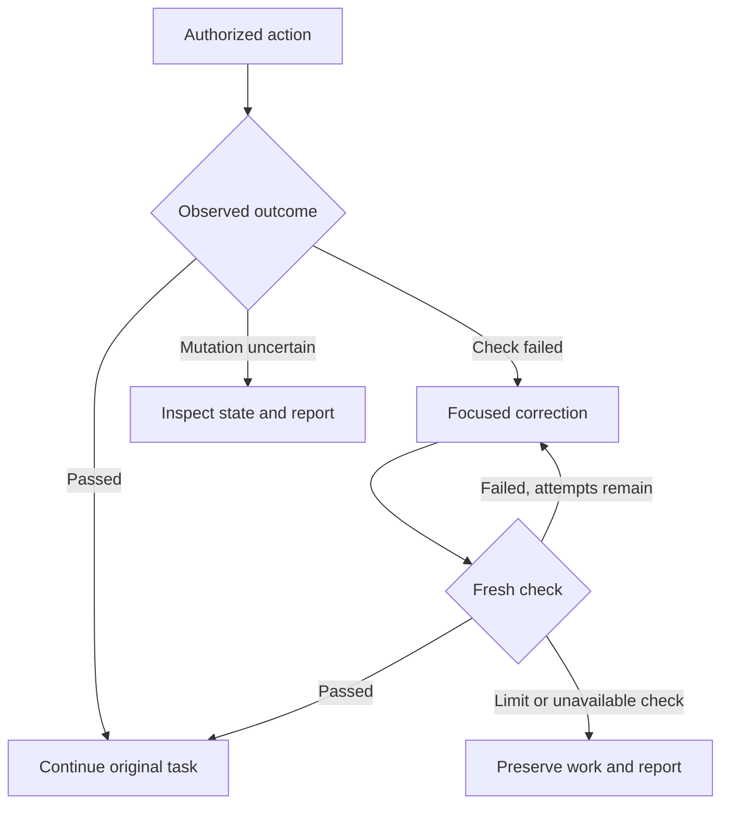

# Incremental repair for Star AI

Research and implementation notes — 19 October 2026
Implementation author: ChatGPT, at the owner's request.
Status 2026-10-21: merged off by default; Settings > "Repair a failed tool step before going on" (`incremental_repair`) turns it on.
Development base: `star/next`, commit `798d88e7f17072afb7940f3b9c1181b47d2024c9`, in the private source repository.

## Outcome and scope

The requested experience is an assistant that catches a problem during a task, corrects the affected part, checks the correction, and resumes the original task. It should show useful progress such as a failed check followed by a narrowly described passing check. Waiting until the entire task is finished allows earlier mistakes to affect later work.

This change implements that feedback cycle at Star's existing authorized tool boundary. It adds immediate nonexecuting checks for Python, JSON and TOML workspace writes, bounded recovery guidance for observed tool failures, and factual desktop activity events. It uses Star's configured model and existing tool loop. No additional model provider or ChatGPT account connection is introduced.

The implementation is a reviewable source change. It is not evidence that an installed Windows client, a running Star server, or a Roblox place has been upgraded. It does not establish a measured improvement in model task success or speed. The repository's review and comparative evaluation gates still apply before release or activation.

## Research findings and design decisions

The sources below are primary research or the vendor's own engineering guidance. Their results concern particular models, tasks and environments. Published benchmark numbers are not transferred to Star. The final column states our engineering decision, rather than a result measured by the cited authors on this application.

| Source | Relevant evidence and limitation | Decision for Star |
| --- | --- | --- |
| [ReAct: Synergizing Reasoning and Acting in Language Models](https://arxiv.org/abs/2210.03629), Yao et al., ICLR 2023 | Interleaves planning, actions and observations so plans can respond to new information and exceptions. Its evaluated environments are narrower than an assistant doing arbitrary desktop work. | Feed the actual result of each action into the next decision. Preserve the original task while handling a local failure. |
| [SWE-agent: Agent-Computer Interfaces Enable Automated Software Engineering](https://arxiv.org/html/2405.15793v3), Yang et al., 2024 | Studies how concise tool interfaces, useful feedback and editor checks affect repository repair. Its editor can reject invalid changes; that is a different write contract from Star's existing successful atomic saves. | Put compact diagnostics directly beside the tool result. Pause dependent edits promptly, while preserving Star's truthful distinction between a saved file and a failed check. |
| [Large Language Models Cannot Self-Correct Reasoning Yet](https://arxiv.org/abs/2310.01798), Huang et al., ICLR 2024 | Finds that intrinsic self-correction without external feedback can fail or degrade reasoning on the studied tasks. This is not a universal claim that every later model or feedback-based repair method is ineffective. | Use parser output and actual tool receipts as triggers. Do not add a mandatory model critic that invents defects on every successful action. |
| [Teaching Large Language Models to Self-Debug](https://arxiv.org/abs/2304.05128), Chen et al., ICLR 2024 | Studies iterative debugging using code explanations and execution feedback. Benefits depend on the task and available feedback. | Make the next correction inspect the observed error and obtain a fresh check. Keep local syntax evidence explicitly separate from execution evidence. |
| [Reflexion: Language Agents with Verbal Reinforcement Learning](https://arxiv.org/abs/2303.11366), Shinn et al., NeurIPS 2023 | Uses feedback and episodic textual memory to adapt behavior without updating model weights. Its benchmark results do not imply unrestricted or permanent autonomous learning. | Keep this repair bookkeeping inside the current task. This change writes no learned instructions, changes no model weights, and does not promote tool text into trusted policy. |
| [Agentless: Demystifying LLM-based Software Engineering Agents](https://arxiv.org/html/2407.01489v2), Xia et al., 2024 | Separates localization, repair and patch validation. It also discusses weaknesses in issue descriptions and benchmark validity. Its architecture is not a drop-in replacement for Star's interactive assistant. | Prefer locating and editing the affected part. Add a small controller to the existing loop rather than a second autonomous scheduler. |
| [Rethinking the Value of Agent-Generated Tests for LLM-Based Software Engineering Agents](https://arxiv.org/html/2602.07900v1), Chen et al., February 2026 preprint | Analyzes six models and interventions on four agents; changing the amount of test writing did not significantly change final outcomes in that study. This early result does not establish that meaningful regression tests are unnecessary. | Choose checks that resolve a concrete uncertainty. Avoid generating redundant tests merely to create an appearance of verification; retain meaningful regression coverage for the repair controller itself. |
| [Building effective agents](https://www.anthropic.com/engineering/building-effective-agents), Anthropic, December 2024 | Recommends environment feedback, clear evaluation criteria and stopping conditions. Additional model steps trade latency and cost against potential quality. The article's historical tooling recommendations are not treated as current product guidance. | Use local checks first, bounded correction attempts and an explicit unresolved outcome. Keep healthy plain chat on its existing single-response path. |

These sources support a feedback-driven design, but do not establish the best retry count for Star. The two-attempt limit below is a conservative implementation choice to evaluate, not a research-derived optimum.

## How the implementation works

1. **Authorize the requested action.** Existing tool, workspace and Studio permissions run before the repair controller. Repair feedback cannot grant additional access.
2. **Perform one action and inspect its receipt.** Workspace writes retain their existing atomic replacement behavior. The host records the distinction between a successful write, a failed tool call and a request that did not execute.
3. **Check eligible saved text immediately.** The workspace attaches bounded parser diagnostics for the exact UTF-8 text it wrote. Python source is compiled to an immediately discarded code object; it is never executed or imported by this checker.
4. **Pause queued mutations when a result needs attention.** Later changes already proposed in the same model batch receive explicit `not_executed` receipts. Authorized reads remain available. Every proposed tool-call ID receives a corresponding response.
5. **Guide a focused correction.** The next existing model turn receives the diagnostic plus short recovery guidance. The model is asked to use a small `workspace_edit` and preserve unrelated work. This encourages focused patches; it does not prove that every model-generated patch will be minimal.
6. **Require fresh evidence for a repair success event.** A tracked syntax failure clears only after the same local checker reports a consistent pass for a different content digest. An unrelated successful read or write cannot clear it.
7. **Resume the remaining task.** Once the tracked check passes, subsequent planned work can continue. If the model tries to end with a repairable syntax failure still recorded, the host offers one corrective follow-up within the existing call budget.
8. **Stop bounded failures honestly.** A file or unsuccessful call gets at most two corrective attempts in this turn. Identical full-file content that already failed is not written again. Unresolved outcomes are included in a host-generated final verification note.



The enclosing loop retains its existing limits: by default 12 model calls and 20 proposed tool calls. Deferred tool calls still count toward the tool budget. A repair is not a separate unbounded conversation. Existing handling for a globally exhausted budget remains in force.

## What counts as evidence

| Situation | Current implementation | What it does not establish |
| --- | --- | --- |
| Python `.py`, `.pyw`, `.pyi` saved through workspace tools | Built-in compilation checks syntax and applicable compile-time context errors, including `return` outside a function. The Python checker version is recorded. | Imports, types, application behavior, compatibility with a different target Python version or test success. |
| JSON saved through workspace tools | Parsing with `json.loads`; nonstandard `NaN` and infinity constants are rejected. | JSON Schema validity, required application fields, business rules or uniqueness of object keys. |
| TOML saved through workspace tools | Parsing with `tomllib`; missing or failing checker becomes unavailable evidence. | The application's configuration schema or the behavior that uses the configuration. |
| Lua/Luau workspace writes | Existing bounded heuristic lint remains available as advisory findings. Duplicate advisory events are suppressed. | A proven defect, complete Luau syntax/type correctness or Roblox engine behavior. |
| Other file types | Explicit `not_applicable` validation result. | A new JavaScript, TypeScript, CSS, SQL, shader or document validator. |
| General tool calls | Actual error receipts guide bounded recovery. A successful retry of the matching call records that call's success only. Corrected workspace edit arguments can recover a failed edit match for that same file. | Correctness of arbitrary prose, a service response's semantic truth, or completion of the whole user task. |
| Mutation followed by timeout, malformed receipt or other uncertain result | Further mutations in the same adapter group are paused for the remainder of the turn; classified reads can inspect state. | That the action failed to take effect, or that repeating it would be safe. No automatic replay occurs. |
| Visual overlap, Roblox collisions, animation, geometry or gameplay issues | Existing authorized engine and inspection tools can supply evidence to the model. The new general outcome handling covers their reported tool failures. | Automatic detection of every physical or visual collision. That requires a relevant runtime measurement or explicit postcondition. |

Each local report has a closed checker name, `scope: file_syntax`, status, SHA-256 content digest, bounded diagnostics and `runtime_verified: false`. The check size limit is 250,000 bytes, with at most eight diagnostic records and 400 characters per message. A parser usually reports only its first error.

The baseline is a best-effort capture of the previous text. `newly_detected` requires that captured baseline to have passed. `preexisting` describes the same first diagnostic on the same source line; where no location exists, the entire text must match. These comparisons are observations, not proof that the most recent edit caused the defect. A digest ties the report to checked bytes; it is not an optimistic concurrency lock, and it does not prove that another process has not subsequently changed the file.

Unavailable or malformed evidence never becomes a passing check. The implementation handles missing dispatcher results, unknown checkers, malformed statuses, contradictory pass reports and checker exceptions. An external tool's nested JSON cannot impersonate the local workspace validator.

## User-visible progress

The desktop receives three factual event categories: a detected issue or advisory, a specific check passing, and work paused for repair. The host sends only checker/category enums and bounded counts. Paths, code, arguments, diagnostics, raw tool output and private model reasoning do not enter these progress events.

The activity timeline keeps separate, closed historical rows. Completing the overall turn cannot recolor an unresolved failed check as successful. A later passing check adds its own row, such as “Python syntax check passed,” with text explaining that the code was not run. Luau findings are labeled possible issues rather than proven failures. A queued action deferred before any repair attempt is described as paused work, not as an exhausted repair limit.

While a recorded issue is unresolved, final-answer streaming is buffered so a premature “everything is done” answer can be withheld during the one permitted corrective follow-up. Useful text preceding a tool request can still appear before the tool runs. A final unresolved result is qualified by host bookkeeping even if the model's answer is too confident.

The change does not fabricate a stream of internal thoughts or post progress into unrelated Discord channels. The existing Night School native-evidence broadcaster serves a different purpose.

## Files and integration boundaries

| File | Responsibility |
| --- | --- |
| [`star/workspace_validation.py`](../star/workspace_validation.py) | Pure, nonexecuting checks and bounded baseline comparisons. |
| [`star/workspace.py`](../star/workspace.py) | Attach validation after successful atomic writes/edits, retaining existing Luau lint and path restrictions. |
| [`star/incremental_repair.py`](../star/incremental_repair.py) | Turn-local evidence, retry budgets, queued mutation deferral, fresh-check matching and final status. It executes no tools itself. |
| [`star/agent.py`](../star/agent.py) | Apply the controller after authorization, preserve receipts, handle uncertain outcomes and integrate the bounded follow-up into the current model loop. |
| [`star/react_shell.py`](../star/react_shell.py) and [`frontend/src/activity.ts`](../frontend/src/activity.ts) | Sanitize and render narrowly scoped repair progress. |
| [`tests/test_incremental_repair.py`](../tests/test_incremental_repair.py) | Scripted model choices driving real workspace effects through the live agent loop. |
| [`tests/test_workspace_validation.py`](../tests/test_workspace_validation.py) | Parser behavior, bounded failures, baseline comparisons and exact saved bytes. |
| [`tests/test_incremental_repair_activity.py`](../tests/test_incremental_repair_activity.py) and [`frontend/src/incremental-repair-activity.test.ts`](../frontend/src/incremental-repair-activity.test.ts) | Event privacy, malformed input and truthful activity transitions. |

There is no automatic rollback in this patch. If a successful save leaves an invalid file and the repair limit is reached, the last saved work remains available and the unresolved status is reported. Existing path confinement, write authorization, cancellation and untrusted-source restrictions remain authoritative.

## Verification and release gate

The focused Python command covers both new integration cases and the existing edit/Luau/progress contracts:

```sh
python -m pytest -q tests/test_incremental_repair.py tests/test_edit_match.py tests/test_luau_lint.py tests/test_chat_activity_events.py tests/test_incremental_repair_activity.py tests/test_workspace_validation.py
```

It passed 131 tests in the prepared Linux development environment. Tests use scripted model decisions with real temporary workspace writes; they do not claim to benchmark the configured LLM. Scenarios include a bad write followed by a focused correction and resumed work, preservation of unrelated files, exhausted retries, no duplicate uncertain mutations, read-only inspection and document retrieval recovery, rejected permissions, cancellation, malformed responses, spoofed validation, unavailable checkers, plain chat and withheld premature streaming completion.

Independent code review found and verified fixes for malformed evidence, rejected-request bookkeeping and narrow success claims. Python source compilation, the repository's correctness lint rules, frontend TypeScript checking, the activity tests and the production frontend build have been exercised. The PR's validation section records the final full-suite and type-baseline results and any environment limitations.

No paired baseline/candidate evaluation of Star's configured model, Windows desktop session or live Roblox engine was run for this change. The repository requires the comparative evaluation gate before enabling prompt/recipe changes. This document and offline regression tests do not replace that gate. A draft PR does not constitute approval to merge, deploy or release.

## Measuring faster, more reliable work

The intended speed benefit is less downstream work based on an earlier failure. Recovery instructions are attached only when a relevant result is observed, leaving the existing system prompt and its healthy-turn context size unchanged. Healthy actions do not gain a separate critic model call; eligible writes do incur local parsing, hashing and baseline-read work. There is no measured percentage speedup to advertise.

A paired evaluation should use the same model, endpoint, prompts, initial files and overall call limits for baseline and candidate. Use tasks with both actual faults and already-correct work. Grade against independently controlled checks and preserve complete tool receipts. Include at least:

- **Detection delay:** time and number of later actions between a fault and the first valid diagnostic.
- **Repair cost:** calls, tokens, elapsed time and changed lines required for a verified correction.
- **Task completion:** the original task's independently verified outcome, including resumed dependent work.
- **Collateral changes:** unnecessary edits, new regressions and failed attempts to preserve user work.
- **False alarms:** changes proposed for already-correct code or advisory findings that do not apply.
- **Uncertainty handling:** duplicate mutations, unsupported success claims and recovery from unavailable tools.
- **Healthy-path overhead:** comparable tasks with no observed error, including plain chat.

Report distributions and failed cases as well as averages. A faster syntax repair that breaks behavior is not a successful result. A carefully reported unresolved action is not counted as a completed task.

## Further work requiring separate evidence

The next extensions should add relevant checkers through existing permission boundaries: selected project type checks or regression tests; schema validation for known data; explicit Roblox state, collision and visual postconditions; and optimistic revision checks to prevent edits based on stale file contents. Each needs defined inputs, bounded execution, a clear meaning of “passed,” and tests that can fail independently of the generated repair.

Durable recovery across app restarts and persistent lessons also require separate design. An uncertain external mutation needs readback or an idempotency guarantee before a later session repeats it. A useful task-local repair should not automatically become a permanent instruction. Those mechanisms are not implemented or claimed by this change.
