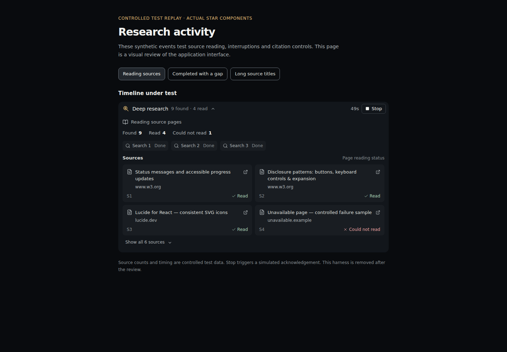

# STAR deep research and activity: evidence, design, and verification

**Research date:** 19 October 2026 UTC. **Inspected baseline:** private repository `main`, commit `0d7bfdb838435221ab60ecd83687e896d34b568e`.

This work develops a reviewable research capability for STAR and a clearer account of what it actually did. The goal is better evidence collection, fewer repeated operations, bounded resource use, and source cards with useful activity feedback. It does not establish that STAR has become a stronger foundation model, surpassed commercial research systems, or improved by a measured percentage. Code in a candidate branch, an enabled feature, and a deployed application are different milestones.

## 1. What the inspected application already did

The baseline `star/deep_research.py` plans three deterministic search angles: the original question, primary/official material, and limitations/comparisons. Its concurrency constant is one. Although the coroutines are gathered together, the semaphore makes the actual searches sequential. It merges at most eight source snippets, removes duplicate URLs, and favors different domains. The code explicitly says it does not open pages.

`star/team_service.py` supplies those snippets to three read-only specialists—evidence, design, and critic—then synthesizes their outputs. The critic can suggest one related follow-up query through `star/autonomous_research.py`. That gives the baseline at most three initial searches plus one accepted follow-up, not a general recursive browsing agent. The existing source footer accurately describes snippets as unopened and unverified. These observations come from reading the named baseline files; they are not latency or quality benchmark results.

The repository also already contains a bounded public HTML/text reader in `star/web_fetch.py`, cancellation helpers, measured model-stream timing, and a React activity timeline with local icons and reduced-motion support. Reusing these components keeps the change smaller and preserves established boundaries. A new orchestration layer should not silently broaden access to private URLs, credentials, local files, or executable tools.

## 2. Findings that drive the design

Research quality requires a cycle of finding evidence, inspecting it, identifying gaps, and synthesizing a qualified answer. Anthropic describes orchestrator/worker research and the importance of explicit responsibilities and effort limits; its results are specific to its system and evaluation [11]. Its broader agent guidance recommends adding architectural complexity when the task warrants it [13]. For STAR, that supports a small, inspectable controller before a large framework migration.

Separate web concurrency from model concurrency. Network waits can overlap without starting another inference engine. On one local CPU, additional simultaneous model requests compete for the same resources. The appropriate inference parallelism depends on the model, context, hardware, and workload; it must be measured. The new research collection layer does not increase the specialist model-call count.

Python's structured concurrency and timeout facilities provide cancellation propagation and cleanup mechanisms [1]. HTTPX separately configures connect, read, write, and pool timeouts [2], while connection limits control resource use [3]. A read timeout measures inactivity, so the research session also needs a cumulative wall-clock deadline. A slowly trickling response must not keep the whole job alive indefinitely.

Context length is also a resource. Anthropic's context-engineering guidance discusses compaction, structured notes, and retaining relevant material across long tasks [8]. For STAR, extracted passages should remain associated with their original source and offsets. Repeatedly summarizing summaries without those associations would weaken verifiability.

Finally, real links are insufficient evidence of correctness. ALCE evaluates answer correctness and citation quality separately [9]. This change therefore distinguishes citation-reference integrity from whether a passage actually supports a claim. A valid source identifier attached to an incorrect statement must not receive a “fact verified” badge.

## 3. Candidate implementation and activation

The change introduces `star/research_session.py` and integrates it into the existing Team + Research path. The new `deep_research_enabled` setting defaults to `False`; the new collection path requires both the explicit Research request and that setting. The legacy snippet path remains available. The feature must satisfy the repository's review and evaluation requirements before activation in a distributed build.

The agreed session contract is:

| Operation | Meaning |
|---|---|
| `ResearchSession(question, *, searcher, fetcher, on_event, budget, queries)` | Construct one bounded research run using trusted application-provided callables and an optional related-query plan. |
| `await collect()` | Run the initial search angles and permitted page reads. |
| `await followup(candidate)` | Accept at most one related, nonduplicate follow-up within the original limits. |
| `context(max_chars=...)` | Produce bounded source-associated model context. |
| `source_manifest()` | Return source metadata, status, hashes, and extract locators without full page bodies. |
| `summary()` | Report actual attempts, outcomes, duration, concurrency, and stop reason. |
| `validate_citations(answer)` | Check referenced source IDs and URLs; report semantic support as unchecked. |

The small programmatic defaults and the broader candidate Team profile are deliberately separate:

| Limit | API default | Candidate Team profile | Absolute accepted budget ceiling |
|---|---:|---:|---:|
| Search queries, including follow-up | 4 | 8 | 12 |
| Page attempts | 6 | 12 | 24 |
| Discovered sources | 16 | 32 | 40 |
| Simultaneous retrieval operations | 2 | 3 | 4 |

These are resource ceilings, not promises to exhaust every allowance. Budgets may be reduced. The new deterministic `deep_queries` helper supplies seven research angles, adding implementation, measurement, failure, and disagreement questions to the original three. A trusted caller can supply a tuple of up to eight queries. Admission checks reject malformed/control/URL content and require topical word overlap; that is a bounded input rule, not proof of semantic relevance. Duplicate queries collapse without consuming another slot. Initial searches preserve capacity for one critic follow-up, and initial collection reserves two page slots when a follow-up is possible and the page allowance exceeds two.

A cumulative deadline covers collection and the later follow-up; elapsed specialist work does not reset it. A valid follow-up can therefore be skipped when the deadline is already exhausted. That is visible bounded behavior, not a hidden failed promise of unlimited depth. More permitted page reads can improve available evidence while also increasing total latency; no speed improvement follows automatically from the broader profile.

The candidate still makes three specialist calls and one synthesis call. Its on-device default permits one model call at a time, independently of the three retrieval slots; STAR Server retains its existing configured inference limits. Selected-model context changes the output allowance: the existing character-budget estimate must reach 6,000 before deep research starts; estimates below 16,000 use 700 specialist and 1,000 synthesis output tokens, while larger estimates use 1,000 and 2,000. These are requested ceilings, not measured token counts. Insufficient context produces an error before retrieval or inference. Long objectives use a bounded local-knowledge lookup; any shortening in the model prompt is explicitly marked. This is still a character proxy, not a tokenizer-exact fit guarantee.

The session distinguishes discovered, read, and failed sources. It preserves stable source IDs, requested and final URLs, retrieval time, a page-text hash, publication metadata, and extract locators. Publication metadata supplied by a search provider remains unverified metadata. A retrieval timestamp is not a publication date, and a page read is not a factual endorsement.

The existing public-page reader performs the actual fetches. It already limits response size and text extraction and validates destinations and redirects. This increment does not add authenticated browsing, a general browser, PDF OCR, video understanding, or unrestricted web crawling. Search-provider configuration remains separate from model-provider configuration.

Cancellation re-raises `CancelledError` after joining active coroutine workers. Completed evidence is retained in the session object. A deadline returns a clearly marked partial/timed-out state rather than pretending every planned operation finished. Individual search or page failures do not erase successful sources. Provider exceptions are reduced to safe categories; progress events must not reveal credentials embedded in error strings. Cooperative-provider tests do not prove that every underlying operating-system operation is forcibly interruptible: the existing reader performs DNS validation in a worker thread, whose resolver call may finish after its awaiting coroutine is cancelled.

## 4. Evidence, deduplication, and honest citations

Duplicate query/page work is suppressed for known identities within the session. URL normalization removes fragments and known tracking parameters while preserving parameters that may select another version or document. This matters for software research: `?version=1` and `?version=2` can describe different behavior. A later reference to a known redirect destination reuses the existing source and its original retrieval timestamp; an unseen redirect alias may require another request to discover that relationship. Different domains are useful discovery diversity, but they are not automatically independent confirmation; copied announcements can still share one origin.

Read-page extracts enter the specialists' bounded context with their source identifiers. The user-facing manifest omits raw page bodies and extract text, while retaining enough metadata to identify what was read. The host-generated citation notes distinguish unknown IDs, unknown URLs, and references to sources that were only discovered. Reference integrity is explicitly separate from semantic support.

There is no implemented independent entailment judge, calibrated confidence estimator, or automatic guarantee of comprehensive claim coverage in this increment. A future verifier should identify each factual claim, the relevant passages, and a supported/contradicted/insufficient-evidence result. It should be evaluated against reviewed examples before its output is shown as a quality metric. Model self-confidence and a count of retrieved pages are unsuitable substitutes.

Cross-session HTTP caching remains a follow-on task. RFC 9111 provides the appropriate basis for freshness and revalidation [4]. A future cache should separate raw documents, extracted text, and task-specific summaries; retain access scope; and key derivatives by content/parser/prompt versions. “Latest” requests require suitable fresh lookups or revalidation. Reusing an old summary must never make its underlying fact appear newly checked.

## 5. Activity and icons

The frontend extends the existing activity timeline instead of inventing a second workflow. Its research view consumes real backend events: session start, query start/completion/failure, source start/read/failure, follow-up start, and session finish. Run IDs and event IDs/sequence numbers allow duplicate event delivery to be ignored. Query labels use ordinals; the activity channel does not need to repeat the user's entire prompt.

Source cards show filtered HTTP(S) links and measured discovery/read/failure states. The display boundary hides credentials, recognized signed-query parameters, local address literals, and multicast links, and drops raw objectives, queries, page bodies, provider exceptions, and generated analysis. Display filtering does not replace the fetcher's network authorization. The panel initially limits visible cards and recent queries, with disclosure controls for more detail. A small original magnifier/star mark gives the research area a recognizable identity; existing local Lucide icons provide consistent action and state symbols. Lucide's React documentation and license describe its SVG component use and applicable attribution conditions [17,18]. The existing dependency is reused rather than importing remote images for every source.

The “thinking” experience is a concise account of observable work and progress. It does not display a generated transcript of private model reasoning. There are no invented tool calls, automatic success animations for unfinished pages, confidence percentages, or fake “sources verified” totals. An elapsed-time display means elapsed time. A completed retrieval means a completed retrieval.

Accessibility requirements shape the interaction. Important status changes should be available to assistive technology without taking focus [14]. The stable phase message is the polite live region; ticking clocks, changing counters, and the entire growing history should not be announced repeatedly. Disclosure buttons retain keyboard operation and `aria-expanded` [15]. Existing reduced-motion handling is extended so movement can be disabled [16]. State remains understandable without color alone; contrast and usable target sizes require visual checks informed by WCAG guidance [19,20]. These choices are design requirements, not a claim that a complete accessibility audit has passed.

Stop remains connected to the existing parent cancellation control. The interface can show “Stopping” while the backend cleans up. It must not report success or a finished research answer solely because the user pressed Stop.

## 6. Local speed and provider-specific opportunities

llama.cpp exposes continuous batching, prompt-prefix reuse, separate generation/prefill thread settings, slot controls, NUMA options, constrained output, and timing metrics [5]. Availability depends on the installed build. Before changing deployment flags, record the build, model/quantization, context size, CPU topology, and actual current settings.

Measure prompt ingestion separately from token generation. `llama-bench` supports both, combined tests, context depth, and repeated machine-readable measurements, but excludes tokenization and sampling [6]. It is a useful diagnostic, not the end-to-end research benchmark. Compare one, two, and four local inference requests only where supported; select a setting based on completed-answer latency, throughput, memory, and quality.

AMD's August 2026 ZenDNN article is relevant but conditional. Its performance results use specific EPYC hardware, formats, and a highly batched workload. The article reports limitations for small-batch decoding, additional quantization formats, and older Zen 3 processors [7]. An older EPYC running a K-quant model must not inherit an advertised speedup from that different configuration. No CPU speed improvement is claimed by this change.

Optional cloud adapters should advertise actual capabilities instead of assuming complete API parity. Claude prompt caching requires an identical reusable prefix and has provider-specific lifetimes; it does not accelerate output-token generation [10]. Such caching is separate from web freshness. No new paid provider, token budget, or cloud transmission is activated by this research change.

## 7. Independent verification and remaining evaluation

Three new test modules exercise the public session API, real Team orchestration, and display/report boundaries using controlled offline providers. Existing tests, fixtures, graders, and stored baselines are not rewritten. Call logs independently check global query/page limits, source caps, duplicate suppression, genuine overlap, stable identifiers, and feature-flag behavior. Event barriers test real coroutine cancellation and whether active workers are joined. Other cases check deadlines during search and page reading, retention of completed evidence, exact clipped-excerpt offsets and complete frames, secret redaction, read/unread labels, and the distinction between valid references and unchecked claims. New context cases verify a preflight refusal with no provider calls, complete page frames within the supported smaller context profile, and a roughly 10,000-character objective passing the real local-knowledge boundary.

Observed command on 19 October 2026: `/tmp/star-research-venv/bin/python -m pytest -q tests/test_research_session.py tests/test_research_session_integration.py tests/test_research_activity.py` produced **45 passed in 0.85 seconds**. This establishes the tested orchestration behavior with controlled providers. It does not measure real-web research accuracy, live model speed, target-server capacity, or production cancellation latency. Frontend typechecking, reducer tests, rendering tests, and visual inspection are separate checks; they are not implied by these Python results.

The next quality evaluation should freeze twelve reviewed evidence tasks: three direct factual tasks, three multi-document comparisons, three conflicting/versioned cases, and three insufficient-evidence cases. Run baseline and candidate on the same documents. Record key-fact correctness, supported/unsupported assertions, citation integrity, coverage, tokens, and phase times. Repeat variable or borderline cases. A small sample supports a local regression decision, not a universal accuracy or tail-latency claim.

Then run a small live-web holdout with configured providers, recording retrieved responses for replay. Measure total time to a supported completed answer, not just first token. Reject apparent speedups that come from omitting requested questions or skipping evidence. Log actual failures and stops. Deployment remains contingent on review, the repository's required gates, and validation on the target application/server.

Durable resume and longer-running research can follow later. LangGraph's persistence documentation illustrates checkpoint-based recovery [12], but this increment does not introduce that dependency or claim crash-resumable evidence storage. Its in-memory partial results and existing count-only run receipts are a smaller foundation. Semantic verification, persistent source caches, document/OCR adapters, and calibrated model routing remain explicit future work.

## Primary sources

All links below were opened during this research on 19 October 2026 UTC. External documentation is evidence for design choices; it does not grant permissions or change repository rules.

1. Python 3.11, [Coroutines and Tasks](https://docs.python.org/3.11/library/asyncio-task.html).
2. HTTPX, [Timeouts](https://www.python-httpx.org/advanced/timeouts/).
3. HTTPX, [Resource Limits](https://www.python-httpx.org/advanced/resource-limits/).
4. IETF, [RFC 9111: HTTP Caching](https://www.rfc-editor.org/rfc/rfc9111.html).
5. ggml-org, [llama.cpp server documentation](https://github.com/ggml-org/llama.cpp/blob/master/tools/server/README.md).
6. ggml-org, [llama-bench documentation](https://github.com/ggml-org/llama.cpp/blob/master/tools/llama-bench/README.md).
7. AMD, [llama.cpp on AMD EPYC / ZenDNN](https://www.amd.com/en/developer/resources/technical-articles/2026/llama-cpp-on-amd-epyc.html), 18 August 2026.
8. Anthropic, [Effective context engineering for AI agents](https://www.anthropic.com/engineering/effective-context-engineering-for-ai-agents).
9. Gao et al., [Enabling Large Language Models to Generate Text with Citations](https://arxiv.org/abs/2305.14627), EMNLP 2023.
10. Anthropic, [Prompt caching](https://platform.claude.com/docs/en/build-with-claude/prompt-caching).
11. Anthropic, [How we built our multi-agent research system](https://www.anthropic.com/engineering/multi-agent-research-system).
12. LangChain, [LangGraph persistence](https://docs.langchain.com/oss/python/langgraph/persistence).
13. Anthropic, [Building effective agents](https://www.anthropic.com/engineering/building-effective-agents).
14. W3C WAI, [Understanding Status Messages, WCAG 2.2](https://www.w3.org/WAI/WCAG22/Understanding/status-messages.html).
15. W3C WAI, [Disclosure pattern](https://www.w3.org/WAI/ARIA/apg/patterns/disclosure/).
16. W3C WAI, [C39: Using prefers-reduced-motion](https://www.w3.org/WAI/WCAG22/Techniques/css/C39).
17. Lucide, [React guide](https://lucide.dev/guide/react).
18. Lucide, [License](https://lucide.dev/license).
19. W3C WAI, [Understanding Non-text Contrast](https://www.w3.org/WAI/WCAG22/Understanding/non-text-contrast.html).
20. W3C WAI, [Understanding Target Size (Minimum)](https://www.w3.org/WAI/WCAG22/Understanding/target-size-minimum.html).

## 8. Interface review and delivery evidence

The new reducer and component tests passed: 54 new cases, plus 38 existing activity/source/motion cases, for 92 tests across six files. TypeScript checking passed. A production Vite build also completed; it retained the existing large-chunk warning, and no dependency changes were made for this feature.

A real Chromium review exercised the actual application components and styles with clearly labeled controlled events. Four scenarios covered ongoing research, partial completion with reference checks, a 390-pixel layout, and long titles at 320 pixels. All four had zero axe violations and zero incomplete results, no horizontal overflow, no visible controls smaller than 24 by 24 pixels, and no console or page errors. Keyboard disclosures, visible focus, reduced motion, and a simulated Stop acknowledgement were checked. These results do not represent a live model or native Windows run.

The review found and fixed a timer semantic issue: the elapsed clock now has the timer role and explicitly silent live behavior. The phase announcement remains the single active polite live region.

[320-pixel layout preview](assets/deep-research-mobile-20261019.png) · [Recorded browser checks](STAR_DEEP_RESEARCH_ACTIVITY_20261019_QA.json)

A separate live transport diagnostic attempted three official public pages with the existing guarded reader. This executor could not resolve the public hostnames, so all three reads were refused and zero were reported as read. The destination guards were preserved. Recorded-response transport tests and controlled-provider integration pass; target-server live retrieval and answer quality still require validation.

Activation remains subject to the repository's `AGENTS.md` evaluation rule. The existing evaluation CLI routes `auto`, `fast`, and `agent` requests through ordinary chat; it does not yet directly exercise this new Team + Research candidate. Team + Research needs a reviewed evaluation adapter and suitable baseline/candidate results before promotion. This change does not edit that harness, its reference answers, its stored baselines, or the gate. The candidate stays off by default and belongs in a draft review until the controlled evaluation owner supplies appropriate paired evidence and the Windows application is checked.

### Final integration checks

The fully hydrated repository regression run completed with **9,635 Python tests passed, 122 skipped, and four warnings** in 152.83 seconds. The full frontend suite completed with **616 tests passed across 65 files**. These are test-suite results, not research-quality or server-speed measurements.

A final privacy review separated the search-suggesting critic from automatically retrieved private project notes and from the other specialists' drafts. It still receives the explicit user objective and public source excerpts. Evidence, design, and synthesis retain the authorized local notes. Two additional behavioral tests cover serial and parallel execution with an adversarial public page: a real follow-up search is dispatched without the private marker, while the local analysis stages retain that marker. This addresses that specific private-note path; the explicit user objective remains part of the user-authorized search flow.

Final focused research verification: **47 new Python tests passed** across all four new modules in 1.24 seconds, including the final private-note boundary. Together with the 54 new frontend cases, this change adds **101 passing new tests**.
