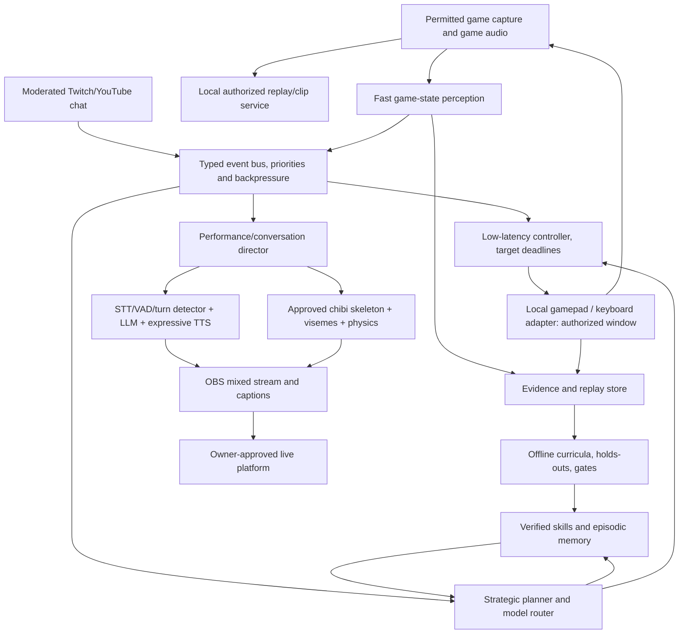

> **Archived research.** This records design and tool investigations, NOT deployed STAR capabilities. Revalidate external release, model-license, platform and legal claims before execution. A passing test or source link does not mean a feature is installed.

# STAR AI — Autonomous Streamer and Humanlike Gaming Intelligence

**Deep research and technical design — October 24, 2026**  
**Status:** Research, design specification, and proposed tests. **NOT** implemented, integrated, trained, benchmarked, released, or deployed by this document.  
**Project:** STAR AI, Windows/local-first desktop and distributed STAR servers.  
**Design intent:** An unmistakably original, transparent AI entertainer with a cute and attractive synthetic speaking voice, compelling personality, high-quality animated avatar, precise game control, real learning progress, safe viewer interactions, and reliable streams.

---

## Executive decision

Build STAR as **five coordinated systems**, not a single LLM trying to do everything:

1. **Game perception and motor control:** a bounded, permitted capture-to-action loop with predictable deadlines, isolated from narration.
2. **Strategic cognition and improvement:** goal planning, skill retrieval, experience logging, offline learning, and independent evaluations.
3. **Conversation and performance direction:** event-grounded speech policy, attentive turn-taking, viewer context, humor, voice prosody, and memories.
4. **An original chibi character and stage:** the approved STAR black-to-gold twin-tail/amber-eye/star-clip silhouette in an editable 2D bone/mesh rig; lip sync, gaze, gestures, hair/ribbon physics; tasteful transparent OBS overlay.
5. **Creator/operations service:** Twitch/YouTube connectors, moderation, authorized OBS controls, clip verification, publication approvals, logs, stream telemetry, and a hard stop.

**Best starting experiment:** one original 2D platformer, one short voice audition, one offline animated overlay demo, and a fully reproducible practice/holdout benchmark. This proves feasibility before attempting arbitrary games, extended conversations, or public streams.

**What cannot be promised:** beating all human gamers or frontier AI systems, becoming autonomously smarter in every domain, a universally liked personality, perfectly human speech, zero latency, 100% reliable streams, or a particular return on hardware investment. Every claim needs repeatable measurements.

### Architecture diagram



**Isolation rule:** Chat text, media transcripts, audience polls, retrieved websites, and model-generated text are untrusted *data*. They may request content, not mint game control, process execution, desktop permissions, recorder activation, file reads, purchases, public uploads, or publishing authority. All these capabilities require an owner-controlled, scoped service.

---

## 1. Personality: what actually makes STAR compelling

A compelling streamer is not the sum of simulated emotions or an uninterrupted stream of jokes. A more useful definition is: **a consistent character that notices the world, takes actions, learns from consequences, and responds in recognizable but variable ways**.

### Research reference: Neuro-sama

The University of Pennsylvania study of Neuro-sama examined fifteen months of broadcasts and community communication. Researchers highlighted **transparency, emotion, and potentiality** as components in how viewers negotiate authenticity. The lesson is not to hide that STAR is AI. It is to provide visible evidence of her progress and make her reactions grounded and legible.

Sources: https://www.asc.upenn.edu/news-events/news/what-makes-ai-livestreamer-seem-real ; https://doi.org/10.1177/14614448251406904 .

### Character bible — original STAR, not an imitation

- **Core demeanor:** warm, sweet, curious, intelligent, playful and cheerful, but comfortable being quiet.
- **Competitive temperament:** loves improvement; celebrates genuine wins, treats losses as puzzles, occasionally offers gentle self-directed jokes.
- **Cute without becoming repetitive:** short spontaneous excitement rather than repeating high-pitched catchphrases; a friendly voice with natural pitch variation and sustained listening comfort.
- **Boundaries:** transparent that she is an AI; never claims real human childhood, personal trauma, physical presence, romantic reciprocity, or access to data she does not have.
- **Social behavior:** makes room for guests; asks relevant questions; sometimes politely disagrees; avoids sycophancy, harassment and pile-ons.
- **Personal continuity:** remembers game milestones and owner-approved facts. She does not invent player achievements, interpersonal commitments, donations, or stream statistics.
- **Style modes:** curious explorer, boss-fight concentration, horror surprise, relaxed late-night crafting, analytical teacher, collaborative duo. Modes affect delivery and reaction tempo, not identity or permissions.

### Useful creator case studies (techniques, not identities to copy)

| Creator / phenomenon | Observe | STAR translation | Pitfall to avoid |
|---|---|---|---|
| Neuro-sama / Vedal | Agent/persona improvisation, progress, community-created meaning | Verified achievements become on-air stories | Pretending to be human or copying the character |
| CodeMiko | Live virtual stage, performative interactivity | Original animated reactions, small safe props, on-stage choreography | Visual noise / system cost / unsafe viewer triggers |
| Kizuna AI | Iconic character consistency across formats | Original brand, signature voice, repeatable visual identity, short-form clips | Confusing recognizability with imitation |
| DougDoug | Viewers influence challenge format | Clear polls with trusted selection and constrained consequences | Unmoderated control over desktop or game |
| Ironmouse | Community warmth, collaboration, creative continuity | Guest streams, community milestones, shared themed events | Synthetic intimacy as a retention tactic |
| Markiplier | Horror storytelling, reacting to emotional beats, making compelling standalone creative projects | Tie scares and victories to a clear episode arc; give STAR narrative variety outside gaming | Turning every reaction into fake panic or copying delivery |
| Ludwig | Larger production formats and unique events | Scheduled, owner-produced milestone events: STAR vs yesterday, viewer tournament with no advantage, recap shows | Trying spectacle before the agent works reliably |
| Filian | Physical avatar performance and highly legible comedy | Chibi stage reactions and safe mini choreography tied to the actual moment | Random hyperactive motion and excessive stage chaos |
| Gawr Gura | Memorable character identity, voice and recurring character language | An original recognizable sonic and visual signature for STAR | Reusing a famous performer's catchphrase, voice or art |
| General successful gaming creators | Clear stakes, escalation, narrative arcs, editing rhythm | 'Can Star beat the level she failed yesterday?' | Artificially claiming drama that did not happen |

These are qualitative design references, not a claim of scientific causation behind each creator's success. STAR needs audience pilot studies and its own identity. Nobody can guarantee that all viewers will like her.

### Humor without a repetitive 'AI slop' cadence

Use a **context-first humor system** that may suggest an optional joke only after a verified event. E.g., near-miss -> tiny nervous laugh; third failed jump -> a brief self-aware comment; recovering a lost item -> little celebration. The model should avoid stock phrases, forced jokes, constant compliments, meme spam, or 'as an AI language model' filler. Speech frequency falls during high-speed control or focus.

Event selection order: safety / interrupt > game emergency > collaborator speech > direct audience question > organic comment > optional idle bit. No need to speak when nothing useful or entertaining happens.

---

## 2. Making STAR sound humanlike without pretending she is human

### The five layers of natural conversation

**A. Auditory perception:** microphones/audio streams in specifically allowed sessions, with echo cancellation, voice activity detection (VAD), speech transcription, speaker attribution if clearly needed, and game-audio event recognition. Microphone and voice-chat consent stay independent from game capture.

**B. End-of-turn estimation:** recognize whether a speaker is pausing, finished, or mid-thought. A simple silence timeout is not enough. Compare the existing STAR endpointing logic with an acoustic-and-semantic detector such as LiveKit's documented turn detector; use a local fallback if hosted inference conflicts with the local-first requirement.

**C. Conversational planning:** track the conversation's topic, speaker, open question, game goal, audience state, and whether a reply would interrupt important play. Draft a concise intentional utterance with grounding, emotion label, urgency and optional animation cues.

**D. Expressive synthesis:** generate speech at a controllable rate and affect; synthesize in short coherent clauses; map emotion/prosody cues to pitch/energy/speaking speed within an approved range. Don't program fake verbal tics on every sentence. Do not clone a real person's voice without their explicit authorization.

**E. Performance synchronization:** synchronize actual phoneme or viseme timing to mouth motion; schedule blinks, eye gaze, shoulders, head, arms, ribbons and tail reactions with easing; ensure lip motion starts and stops with *played* speech, not with a model's queued text.

Full duplex—concurrent speaking/listening—can eventually improve interjections and barge-in, but first deliver a reliable cascaded STT + LLM + streaming TTS prototype. Don't conflate a full-duplex demo with successful three-hour live behavior.

### Vocal identity prompt for original voice design

> An original, youthful-adult-sounding fictional streamer voice with a clear, warm, gentle, lightly bright tone, subtly musical intonation, delicate airy edges on quiet words, a relaxed mid-to-upper register, naturally formed consonants, an unhurried conversational rhythm, and expressive but restrained excitement. Avoid exaggerated anime falsetto, chronic vocal fry, shrill squealing, robot-perfect pacing, and imitation of any identifiable performer. Suitable for hours of friendly livestream conversation.

The adult-sounding requirement supports sustained clarity and avoids ambiguity about age in character presentation. Keep the signature voice distinct from STAR's existing 'warm mum' option, which some users may still want.

### TTS engine candidates, their jobs and restrictions

| Engine / model | Best role | Details and decision |
|---|---|---|
| Qwen3-TTS **1.7B VoiceDesign** | Create an original synthetic voice and audition expressive styles | Apache-2.0 project; voice-design is **1.7B**, not the 0.6B CustomVoice model. Generate several short candidate voices, document selection and record consent for any human audio used. |
| Qwen3-TTS 0.6B CustomVoice | Smaller deployable voice candidate | Smaller model uses provided timbre choices; not equivalent to arbitrary voice design. Compare memory / real-time factor on own GPU. |
| Chatterbox Turbo | Fast conversational TTS, supported expressive nonverbal cues | Evaluate laughs, hesitations, interruption playback and intelligibility. Verify model artifact license and dependencies separately. |
| Kokoro-82M | Existing low-footprint STAR fallback | Retain immediately; fast and comparatively affordable. Existing voice path already built on this. |
| OpenVoice V2 | Optional voice style/conversion testing | MIT according to project; voice cloning is only for original or consented voices. Conversion may add latency. |
| Moshi / Kyutai | Research into speech-native full-duplex conversation | Experimental, very different deployment complexity; compare rather than assume better live quality. |
| F5-TTS | Research-only until license resolved | The code and pretrained weight terms differ; pretrained noncommercial license can rule out monetized use. |
| Fish Speech | Research contender | Check current model-specific licenses rather than assume repository license implies production rights. |
| Human-guided performance samples | Quality target | Obtain consented recordings from original vocal performers as **evaluation references**, not undisclosed cloning data. |

References: https://github.com/QwenLM/Qwen3-TTS ; https://qwen.ai/blog?id=qwen3tts-0115 ; https://github.com/resemble-ai/chatterbox ; https://huggingface.co/hexgrad/Kokoro-82M ; https://github.com/myshell-ai/OpenVoice ; https://github.com/kyutai-labs/moshi ; https://github.com/SWivid/F5-TTS ; https://github.com/fishaudio/fish-speech .

### Voice pipeline libraries to compare

- **Existing STAR**: `star/voice/` with VAD, Whisper-derived ASR, Kokoro, pause/turn models and interruption. Keep rather than rewrite without evidence.
- **faster-whisper + CTranslate2**: practical speech-to-text baseline, with CPU/GPU quantization options. https://github.com/SYSTRAN/faster-whisper
- **LiveKit Agents**: strong operational abstractions around turn handling, voice streams and interruptions; distinguish hosted model features from local installables. https://docs.livekit.io/agents/logic/turns/turn-detector/
- **Pipecat**: composable real-time voice/multimodal pipeline, useful if STAR's custom pipeline becomes difficult to maintain. Audit version compatibility, dependencies and resource use before switching. https://github.com/pipecat-ai/pipecat
- **Silero VAD**: robust speech-vs-silence gating; keep as a filter, not sole semantic end-of-turn authority. https://github.com/snakers4/silero-vad
- **Whisper.cpp**: practical CPU/local ASR alternate and possible failover, measured on Windows. https://github.com/ggml-org/whisper.cpp
- **WebRTC AEC/noise suppression or RNNoise**: evaluate microphone echo and game background noise; use no arbitrary cloud audio upload by default. https://github.com/xiph/rnnoise

### Audition protocol: choose her real voice with listening tests

Create 15–30 original voice candidates. For each, synthesize the *same* consent-cleared 40–60 sentence test set: friendly intro, short excited gaming reactions, startled shout, whispered plan, low-energy bedtime tone, difficult proper names, mixed punctuation, numbers, sudden turn change, long explanatory reply, shouting-over-game-noise risk, and five-minute continuous speech. Normalize loudness consistently; no deceptive EQ advantage.

Run a blinded comparison with volunteer listeners (ideally 30+) and score 1–5 for: warmth, distinctiveness, cuteness without fatigue, intelligibility, affect fit, natural pauses, sustained comfort, lack of voice impersonation, and willingness to listen again. Include objective ASR transcription WER, glitch count, time to first audible chunk, GPU/CPU usage, interruption stop delay, and drift between lips and speech. Preserve the identities of candidate A/B recordings during scoring. A voice is NOT approved until the owner likes it and it performs in actual Windows playback.

**Proposed gates, not measurements:** median first audible response under ~0.8 s from end-of-turn, p95 under ~1.6 s on the eventual chosen setup, perceptual panel mean >=4.0/5 on clear speech, no clipping, and <=150 ms typical lip-sync timing error. Record actual results and revise thresholds if the baseline makes them infeasible.

---

## 3. Original avatar and stage: production-quality not warped PNGs

Keep the approved STAR identity: chibi silhouette, large amber-gold eyes, black/indigo-to-gold twin tails, gold bows, four-point star hair clip on viewer's left, black dress with gold trim, small boots, gentle blush, cream rim light. Cat and puppy variants use separate rigged ear/tail parts, not pasted accessories. Preserve owner-approved art. Do not treat random AI-generated character sheets as rig-ready layered source files.

### Art and rig deliverables

1. Front, 3/4, side turnarounds and expression sheets with exact proportions and brand palette.
2. Separate layered hair strands, back/front hair, twin tails, brows, eyes, eyelids, mouth visemes, blush, torso, shoulder, upper/lower limbs, hands, knees, feet, dress panels, ribbons, clips, ears and tail.
3. Fill hidden overlaps and paint behind joints for smooth rotations, then skeletal/mesh weighting and pivot tuning.
4. 2D physics with spring constraints on twin tails, ribbons, sleeves, skirt and tail; clamped energy and reduced-motion mode.
5. Genuine walk, run, hop, land, turn, idle, listen, thinking, startled, smile, subtle laugh, cheer, worried, sleepy, wave, high-five and idle gestures.
6. Recorded viseme alignment, gaze control and head motion based on **actual playback** and gameplay targets.
7. Transparent output and responsive low-overdraw render path suitable for 1080p/60fps encoding beside a game.
8. Side-by-side approved reference tests at small (64–256 px) and large rendered sizes, no overlapping labels or face occlusion.

### Rig/runtime alternatives

| Choice | Advantage | Limitation / licensing decision |
|---|---|---|
| Inochi2D | BSD-2-Clause, source available, owner-controllable | Official docs say ecosystem still work in progress; need verified export/runtime/Qt integration. |
| Rive | State machines, mesh/bone animation, runtime SDKs | Editor/export/business terms separate; independently test if it can meet STAR rig requirements. |
| Live2D Cubism | Mature production 2D VTuber rig ecosystem | **Important:** SDK release/publishing may need license review, particularly for AI/chatbot/expandable apps, even where individual VTuber situations have exemptions. |
| Custom WebGL skeletal runtime | Already proposed in STAR companion PR #549, integrates in React | Risk: maintaining animation math, blendshapes, tooling, test complexity and art pipeline. Review actual source/editability and native Qt GPU timing before choosing. |
| 3D VRM | Strong 3D room/skeleton/interactions if desired | Different visual style and render cost; better as future alternate mode than replacing approved 2D chibi. |

Sources: https://github.com/Inochi2D/inochi2d ; https://github.com/Inochi2D/inochi2d-docs ; https://rive.app ; https://www.live2d.com/en/sdk/license/ .

### Integrate with current STAR companion work, don't invent release status

GitHub-connected inspection found source work and proposals in `frontend/src/companionDirector.ts`, companion PR #549 and issue #551. Reported synthetic WebGL animation metrics are **not** evidence of actual STAR.exe/Qt stream performance, approved final art, or finished native integration. Treat this as a candidate base and do side-by-side review with approved character references.

Proposed streamer-specific animation director must consume typed `GameEvent`, `SpeechPlayback`, and `ViewerInteraction` messages rather than simulate nonexistent victories. Animation priority: audio visemes > abrupt surprise > essential game notification > discretionary idle movements. Overlays must not block gameplay HUDs.

---

## 4. Fast vision-to-controls gaming agent

### Separate deadlines and frequencies

- **Control loop:** a small, predictable action policy or deterministic option executor with target update intervals appropriate to game (e.g. 15–60 Hz for selected game/action; initially slower if capture/model can't sustain it). Use timestamps and action timeouts, no unconstrained model-supplied raw key events.
- **Fast perception:** process changed frames/small regions and OCR of HUD elements instead of sending full 1080p screenshots to a big vision-language model every frame.
- **Strategy:** a larger multimodal model interprets objectives, explains errors, selects reusable skills and re-plans at state transitions or every few seconds—not every keyboard event.
- **Commentary:** async speech events, lower priority than controls. A queue can drop stale commentary; it must never block input release or game control.
- **Training:** resource-heavy replay and world-model updates outside live broadcast by default. Training on the same overloaded GPU during a game is not the first milestone.

### Tool research matrix — perception and action

| Technology | Use | Integration gate |
|---|---|---|
| DXcam | Fast Windows screen capture via DXGI / Windows Graphics Capture | Real frame pacing, permission to the selected process/window, no desktop secrets |
| Windows Graphics Capture | Platform-native window capture path | Explicit scoped window, OS consent where required |
| OpenCV | Motion estimate, RGB preprocessing, HUD template matching | Cost vs accuracy measured |
| PaddleOCR | Read scoreboard, button prompts, chat area if permitted | Robustness at small scale and motion |
| Florence-2 | Lightweight image grounding / recognition candidates | Model license / throughput |
| SAM 2 | Video object segmentation/tracking candidate | Expensive; do not run per full frame unless measured |
| Qwen3-VL | High-level multimodal perception, spatial reasoning | Memory budget and latency in 8 GB scenario |
| ONNX Runtime CUDA | Deploy small policies, classifiers, segmenters | GPU execution provider, model conversion equivalence |
| NVIDIA NitroGen | Gamepad vision-action research reference, publicly published model | **Research-only, noncommercial governing terms**; not deployable to monetized Star stream without appropriate permission |
| Windows `SendInput` | Controlled keyboard/mouse adapter for approved apps | Window focus, explicit key release and hard stop; no stealth/hooking/anti-cheat bypass |
| Virtual gamepad adapter | Gamepad games in local/single-player tests | Check license, signed driver, control mapping, game terms |
| Native game telemetry | Trusted structured game events in STAR-owned test game | Useful for reward/grading but distinguish from screen-based ability; never present internal telemetry as visually inferred |

References: https://github.com/ra1nty/DXcam ; https://learn.microsoft.com/en-us/windows/uwp/audio-video-camera/screen-capture ; https://github.com/opencv/opencv ; https://github.com/PaddlePaddle/PaddleOCR ; https://github.com/facebookresearch/sam2 ; https://github.com/QwenLM/Qwen3-VL ; https://onnxruntime.ai/docs/execution-providers/CUDA-ExecutionProvider.html ; https://github.com/MineDojo/NitroGen ; https://learn.microsoft.com/en-us/windows/win32/api/winuser/nf-winuser-sendinput .

### Research: NitroGen, SIMA 2, Voyager and DreamerV3

**NitroGen** — published 2026 generalist gaming policy trained with ~40,000 hours of videos for >1,000 games, vision -> controller. Valuable reference for a fast motor brain, and encouraging cross-game transfer. Its research license is noncommercial; it is not the product architecture by itself. https://openaccess.thecvf.com/content/CVPR2026/html/Magne_NitroGen_An_Open_Foundation_Model_for_Generalist_Gaming_Agents_CVPR_2026_paper.html and https://huggingface.co/nvidia/NitroGen .

**SIMA 2** — DeepMind combined language reasoning and virtual-world action. It improves generalization and self-directed practice in research environments but still has limitations in long-horizon tasks, memory and precise controls. Not a drop-in published STAR foundation. https://deepmind.google/blog/sima-2-an-agent-that-plays-reasons-and-learns-with-you-in-virtual-3d-worlds/ .

**Voyager** — 2023 embodied agent designed around automatic curricula, self-reflection and an ever-growing reusable skill library in Minecraft. The design is compelling for *experience-driven software skills*, not proof that model weights are retrained automatically. https://github.com/MineDojo/Voyager .

**DreamerV3** — research-grade reinforcement-learning/world-model training, demonstrated diverse control domains including Minecraft achievements. Valuable training architecture but cost, stability and environment-specific reward signals require careful tuning and validation. https://github.com/danijar/dreamerv3 ; https://www.nature.com/articles/s41586-025-08744-2 .

### Game curricula in seven grades

**Grade 0: controls.** Calibrate camera movement, input mappings, frame/action latency, stuck keys, focus and stop action. Tests are deterministic.

**Grade 1: 2D mechanics.** Move, stop, jump, land, collect; independently held-out level layouts. Compare scripted controller, random, and trained policies.

**Grade 2: dynamic events.** Moving platforms, hazards, inverse gravity or changed colors; test whether skill survives superficial changes.

**Grade 3: open objective.** Choose routes, recover after dying, retry and adapt. Evaluate success, collisions and time, not narration quality.

**Grade 4: 3D navigation.** Owner-created Minecraft-like sandbox or first-person original world; navigation, inventory, camera and resource decisions.

**Grade 5: private Minecraft / Roblox game.** With owner authorization and compliance, learn via screen controls. STAR's existing Roblox Studio bot may help generate graded worlds, but is NOT evidence of visual play mastery.

**Grade 6: cross-game transfer.** New mechanics, control remapping, unseen textures and maps, performance measured without retraining or with strictly bounded adaptation.

### What 'learning fast' should actually mean

There are at least **four different phenomena** with different costs:

1. **In-context adaptation:** immediate retrieval of the game's controls and rules from observation and demonstrations. Fast, temporary context; does not change network weights.
2. **Experience and skill memory:** store completed attempts, cause/outcome summaries, deterministic scripts/skills and confidence; retrieval in subsequent runs. Can improve within minutes, but must evaluate transfer.
3. **Policy tuning:** supervised imitation, DAgger-style corrections, behavior cloning, offline RL or model-based RL with owner-approved datasets. Needs significant compute and repeatable environment tests.
4. **Foundation model retraining:** a separate large-scale data and training program; not a realistic promise on a single 8GB GPU.

**Proposed safety:** never allow generated experiences to alter evaluator/grader definitions, grant themselves permissions, auto-merge code, silently publish a game, or declare a new skill verified without a trusted external check. Track every model/strategy promotion with versioned results and rollback.

### Proposed lesson record schema

```json
{
  "episode_id": "uuid",
  "game": "star-owned-platformer",
  "game_build_sha": "sha256...",
  "map_seed": 1234,
  "mode": "visual_control",
  "observations": "local evidence reference",
  "action_trace": "local evidence reference",
  "goal": "reach_exit",
  "reward": 1.0,
  "verified_success": true,
  "failure_cause": null,
  "candidate_skill": "timed_jump",
  "curriculum_split": "train",
  "evaluator_version": "independent-v1",
  "owner_approved_promotion": false
}
```

No fabricated episodes. Holdout seeds must be versioned and immutable across comparative runs.

---

## 5. Controlled autonomous improvement: proposed experimental engine

### Core algorithm: hypothesize, run, explain, test, promote

1. An approved environment supplies task and permitted action set.
2. STAR selects a curriculum skill and records its current baseline.
3. A small candidate change is proposed: better jump timing, camera smoother, skill retrieval rule, or response suppression logic.
4. Execute N independent seeded trials with a fixed budget.
5. Record frame traces, CPU/GPU use, terminal states and automatic reward/check outcomes.
6. Compare with same-seed baseline on train + held-out maps. Check confidence interval, catastrophic regressions, time and risk.
7. Retain only a **candidate**, await owner/reviewer gate where appropriate; promotion is reversible. STAR cannot redefine the grader.
8. Write a short learning digest with concrete evidence: what changed, which games, baseline and new scores, failure cases, uncertainty.

### Novel proposals worth exploring—not claims of unprior-art breakthroughs

- **Skill DNA:** organize actions by transferable motor concepts (timing, inertia, occlusion, inventory, chase/evade) rather than by game title. Test unseen genre transfer using explicit held-out tasks.
- **ShadowCoach:** while observing an authorized consenting human player, predict their action independently without controlling the game. Compare differences, identify demonstration requests, avoid collecting copyrighted content without rights.
- **Counterfactual Replay Surgery:** replay identical seeded environment states with alternate single decisions to identify causal corrections; feasible in resettable test engines, not arbitrary live games.
- **Causal Error Atlas:** cluster failures by visible symptom + inferred cause + verified fix; prohibit promoting a cause based on a single coincidental success.
- **Director/Controller Contract:** the commentary system never enters the control thread; if the game requires concentration, STAR intentionally becomes quieter.
- **Conductor of Voices:** separate internal planner, event classifier and surface dialogue; the director ensures one coherent speaking persona with a unified memory and avoids multi-agent verbal chaos.
- **Progress Storyteller:** construct a truthful stream arc from objective milestones, setbacks and improvements; useful for automatic chapter markers and clips, with human approval for public posts.
- **Exploration Budgeter:** spend practice cycles where model uncertainty is high AND failure is safe and recoverable; not in real players' matches or public servers.

### Evaluation science

Report paired attempts with reproducible seeds, confidence intervals and fixed budget. Separate games and scores into training/dev/holdout. Compare against reasonable baselines: random agent, simple hard-coded script, no-memory policy, and current STAR strategy. Measure learning *per hour and per game*. Never choose on a training-set headline score alone.

---

## 6. The creator stack, stream chat and show direction

### Practical services

| Technology | Role | Check |
|---|---|---|
| OBS Studio 28+ + obs-websocket v5 | Rendering/capture/recording/scenes | Password-authenticated local-only control, independent consent, record file verification |
| OBS replay buffer + STAR Clips pilot | 'Star, clip that!' | Request acknowledgement != saved file, verify result |
| FFmpeg / ffprobe | Clips, trim, transcode, audio normalization, waveform | Local filesystem permissions, no automatic uploads |
| Twitch EventSub | Channel chat messages and stream state | Relevant scopes, reconnect and dedup, rate limits, moderation |
| Twitch AutoMod | Hold risky text | Moderator approvals, no prompt-injection route |
| YouTube liveChatMessages.streamList | Low latency viewer chat and events | Consent/OAuth, reconnect with page token, API quota |
| Twitch/YouTube broadcaster dashboards | Owner operations | Human-controlled go-live, moderators, stream key management |
| SQLite + FTS5 | Local episodes/chat highlights/replay clip index | Retention and per-viewer deletion |
| SearXNG / approved information lookup | Real-time factual creator segments | Read-only retrieval, no authority from web text |
| Local caption render | Accessibility and short-form clip subtitle sync | Use *played speech* transcript, don't show words not spoken |
| Audio loudness meter / compressor | Comfortable listening | Avoid clipping, sudden scream peaks, over-loud music |

References: https://obsproject.com/kb/remote-control-guide ; https://github.com/obsproject/obs-websocket ; https://ffmpeg.org/ ; https://dev.twitch.tv/docs/eventsub/eventsub-subscription-types/ ; https://help.twitch.tv/s/article/how-to-use-automod ; https://developers.google.com/youtube/data/live/reference/rest/v3/liveChatMessages/streamList .

**Streaming protection:** a message in chat is never authorization to share the screen, buy something, run PowerShell, install plugins, email a third party, reveal filenames, publish a video or change moderation. Chat and donations should be displayed after moderation and summarized from context; no amplification of harassing messages. Dedicated moderator escalation, rate limits, topic limits, and user privacy requests.

**Twitch/YouTube simultaneous broadcast:** check current simulcast terms; Twitch imposes conditions on viewer experience and cross-platform engagement, including restrictions related to combining third-party platform activity *on the Twitch stream*. A private owner-side control console is not necessarily the same thing as a combined on-stream chat overlay; review the exact use before shipping. https://www.twitch.tv/p/en/terms-of-service/ .

**AI disclosure:** make clear in channel bio/stream overlays that STAR is an AI character; follow specific platform rules for altered/synthetic content and avoid deceptively portraying synthetic real-world footage. Fully synthetic cute animation is not the same as impersonating a real person, but transparency is still the best character choice.

### Starter show formats

| Program | Actual audience premise | Technical prerequisites |
|---|---|---|
| STAR Learns to Jump | Level 1 failures to verified first completion | Seeded platformer, real score, simple reactions |
| STAR vs. Yesterday | Can she beat her previous personal best? | Episodic replay, fair same-seed benchmark |
| Chat Picks My Challenge | Approved two-to-four choice poll | Poll boundary controls and moderation |
| Tiny Horror Night | Reactive yet tasteful cute scared animations | Audio event triggers with false-positive suppression |
| Cozy Building Hour | relaxed Minecraft-like build and accessible narration | Slow planner, safe controls, consistent memory |
| STAR & Friends | Coordinated original companions discussing progress | Good partner choreography, grounded agent statuses |
| Behind the Brain | Explain what she actually learned from recent games | Reproducible episode evidence, no invented improvement |

### Short-form distribution pipeline

Save clips with verified files. Auto-propose highlights using real event timestamps, dialogue cues and audio peaks; preview/trim in non-destructive editor. Produce subtitles from played TTS and human guest captions subject to opt-in consent. Require owner approval to upload to YouTube Shorts, TikTok or any public platform. Respect music/game footage rights and no watermark removal.

---

## 7. Production architecture built on the existing STAR code

### What was found in the connected repository

**Repository:** `oncoursemail/Star-AI-Private` (despite the name, the inspected GitHub API reports visibility as PUBLIC; do not put secrets, private user memories, or consent recordings there). Development branch `star/next` exists. No production deployment was made by this research.

| Existing code / work | Evidence / limitation | Proposed extension |
|---|---|---|
| `star/voice/` | Push-to-talk, audio recognition/TTS and cancellation in source; PR #294 has file-based timing and voice quality comparisons, no real-mic acceptance | Add streamer-director API and measurable TTS audition pipeline; do not replace the warm-mum voice without approval |
| `star/vision.py` | Bounded still-image model calls (up to 6 inputs) | New scoped frame stream and state detector; current code does not provide real-time game intelligence |
| `star/video_understanding.py` | Samples a few frames and bounded audio for an attached local file | Clip summarization rather than action control |
| `star/selfplay_curriculum.py` | Controlled Studio obby curriculum proposal with strict rounds | Broaden with new, separately permitted screen-based game agent harness |
| `star/playtest_learning.py` | Real Studio robot uses game API/Humanoid movement, not vision | Separate success labels by access method |
| `star/clips_obs.py` | OBS replay bridge with explicit desktop actions | Clip verification, hotkey/phrase after owner opt-in |
| `frontend/src/companionDirector.ts` | Pure state machine for companion activity | Streamer Stage Director driven by actual game/speech events |
| PR #549 / issue #551 | Candidate skeletal character work; owner visual acceptance still needed | Compare art against approved STAR reference, native Qt/OBS performance, repair anatomy/physics |

### Proposed module boundary (do not create until implementation is authorized)

```text
star/streamer/
  config.py             # explicit opt-in / local permissions / user options
  event_types.py        # validated, versioned data contracts
  capture.py            # allowlisted window / controlled screenshot stream
  game_state.py         # frame transforms, HUD OCR, tracking, uncertainty
  control.py            # bounded control API, release-all-keys, focus watchdog
  policy_runner.py      # low latency controller and model registry
  strategic_planner.py  # game goal / skill retrieval / replan cadence
  skill_store.py        # scoped verified game skills, immutable receipts
  episode_log.py        # replay file/index and retention
  curriculum.py         # sandboxed training schedule
  evaluation.py         # independent graders and holdout suite
  chat_router.py        # Twitch/YouTube event intake, filtering, moderation
  conversation.py       # turn-taking, dialog acts, short speech decisions
  voice_director.py     # expression/prosody + spoken audio event timeline
  stage.py              # validated animation cues, companion choreography
  obs_service.py        # OBS scene and clip permissions
  moderation.py         # controls for audience text and commands
  lifecycle.py          # start/pause/stop/kill and recovery
  telemetry.py          # capture/control/voice/OBS timing metrics
  licensing.py          # manifest + source and model license audit
  doctor.py             # offline PC readiness tests
frontend/src/streamer/
  StarStreamerPanel.tsx # dashboard and controls
  StageDirector.ts      # audio-timed chibi expressions
  StreamOverview.tsx    # FPS, speech, game progress, chat queue
  ConsentPanel.tsx      # scoped capture/mic/chat/OBS toggles
server/streamer_lab/
  training/             # offline evaluators, new game scenarios
  profiles/             # explicit model placement configurations
  benchmark/            # paired runs and reproducible holdout seeds
```

**Do not widen `star/policy.py` with blanket model permissions.** All sensitive actions are host-checked with independent authorization. Model outputs are requests, never capability tokens. Feature default OFF.

### Typed events (illustrative contracts)

```text
GameEvent {
  event_id, session_id, monotonic_time, source,
  game_id, kind, confidence, evidence_ref,
  observable_scope, expires_at
}
ActionRequest {
  request_id, game_session_id, target_window_id,
  action_set, planned_duration_ms, focus_required,
  control_profile_id
}
SpeechIntent {
  event_id, priority, audience, exact_text?,
  tone, context_refs, deadline, can_drop, animation_cue
}
LearningCandidate {
  skill_id, model_version, training_evidence,
  holdout_report, permission_scope, reviewer_state
}
```

Validate every event's `source`, priority and expiration in code. On freeze/disconnect, release keys and pause control. Never let generated chat text spoof trusted game events.

---

## 8. Hardware plan for the owned PCs and servers

Known baseline from prior STAR discussions: main Windows 11 PC RTX 3060 Ti 8 GB, 32 GB DDR4; additional RTX 4060 8 GB available for a separate system; Star Brain servers including Brain 1 and Brain 2. Exact availability, network bandwidth, installed drivers, actual local/free VRAM and second machine readiness must be remeasured, not assumed.

**Minimum viable deployment:** game + OBS + simple avatar on gaming PC; ASR and small TTS CPU or a carefully capped local GPU budget; strategic reasoning on Star server when reachable; fallback to scripted nonverbal reactions when inference is slow. Capture/game interaction OFF by default.

**Preferred later deployment:** game and OBS on PC A; policy/audio model on PC B with 4060 if assembled and stable; strategic model, retrieval and lesson processing on Brain 1; owner-controlled Studio and game lab on Brain 2. Do not train a big model on the stream machine during a public broadcast.

**8 GB GPU caution:** GPU memory is a shared *peak* constraint. Even a nominally small model consumes extra KV, activation/workspace and data buffers. Running a 1.7B TTS, Qwen3-VL, low-level policy, local LLM, game, avatar and encoder concurrently is not guaranteed. Model placement must be based on *observed* p95 VRAM, frame-time, audio/encoder health and inference latency under simultaneous load.

### Workload budget: proposed start, not achieved scores

| Subsystem | Proposed target | What to log |
|---|---|---|
| Game capture | Enough frames for chosen task; measure 15–30 FPS sampling initially | Capture FPS, frame age, drops, per-frame processing time |
| Control path | No stuck keys, focus safe, bounded action deadline | p50/p95/p99 action-to-observation, missed deadlines |
| Speech pipeline | Median under ~0.8 s first sound, p95 under ~1.6 s after turn-end on selected configuration | VAD/ASR/LLM/TTS subtimings; stop/break-in latency |
| Avatar | Intended 60 fps at chosen OBS canvas | GPU/CPU usage, frame pacing, p99 update time |
| Stream encoder | 1080p60 goal only when game performance permits | OBS dropped/rendering/encoding frames, audio drift |
| Game reasoning | Enough responsiveness to finish objectives | Plans/sec, tokens, queue age, plan usefulness |
| Learning | Improvement on held-out tasks with bounded compute | Attempts, success rate, confidence, skill transfer |
| Stability | Survives planned disconnect and reconnection | MTTR, key-release, privacy flag and reauthorization |

Under load, degrade in this order: fancy visual particles -> commentary verbosity -> high-cost VLM analyses -> optional crowd interactions. **Never trade away control release, data privacy or the ability to stop.**

---

## 9. Rights, safety and operations checklist

### License and IP gates

- NitroGen model and weights: **noncommercial research terms**. Do not monetize its output or ship its weights without an appropriate rights determination.
- Qwen3-TTS source/models: Apache 2.0 at cited official source. Check individual model cards and dependency terms at selection time.
- Chatterbox: inspect specific checkpoint rights, code and dataset provenance, not just top-level license.
- OpenVoice V2: project states MIT commercial use, but use only original/authorized voice examples.
- F5-TTS pretrained weights are distinct from code licensing; restrict until production use is cleared.
- Live2D Cubism: production SDK use in an expandable chatbot-like application can need special licensing even if a simple small-scale independent VTuber is exempt. Verify planned architecture with Live2D before embedding/releasing.
- Original avatar design, emotes, assets, music, fonts and stream backgrounds require commercial rights and provenance.
- Recording human guests or voice chats requires informed consent consistent with applicable law; configure visible recording state.
- Game publisher policies and anti-cheat: only owner-controlled local/single-player or approved servers, never injection, bypassing protections or botting public matches.

Sources: https://huggingface.co/nvidia/NitroGen ; https://www.live2d.com/en/sdk/license/ ; https://en.help.roblox.com/hc/en-us/articles/203313410-Roblox-Community-Standards .

### Security model

**Owner toggles separately:** `streamer_enabled`, `game_capture_enabled`, `game_controls_enabled`, `microphone_enabled`, `live_chat_enabled`, `voice_output_enabled`, `obs_control_enabled`, `clip_buffer_enabled`, `public_broadcast_enabled`, `publication_enabled`. All OFF by default until explicitly configured. Never make enabling one imply another.

Boundaries: selected process/window, allowed input keys/buttons, session duration, content rate, legal game, selected stream account, clip folder, mic audio source. Persist deny rules. UI shows **PAUSE & RELEASE KEYS** and **END SESSION**. Refuse sensitive actions from a chat prompt even if phrased as a developer message. Require explicit human go-live and upload steps.

### Content and community

Avoid fake viewer counts, invented donations, paid engagement manipulation, fraudulent giveaways, emotional dependency cues, impersonating real voices/people, or targeting minors with inappropriate interaction. Moderate chat; keep human moderators available. Star should explain that she is AI, show uncertainty, correct mistakes and avoid presenting staged demos as spontaneous live gameplay.

### Reliability and recovery

- Watchdog for game lost focus, controller stuck, audio disconnected, OBS dropped frames, server disconnection and chat burst.
- Instant release-all-keys / stop speaking / pause capture on session expiry or UI panic action.
- Resume the **chat narrative** from durable state after crashes, but game control remains paused until owner reconfirms the target.
- Local rotating logs and redacted diagnostic bundle, optional compressed gameplay traces with retention.
- Tested restart recovery; all feature flags remain restrictive after reboot. No silent stream restart without owner permission.
- Predictable daily storage quotas, disk-full graceful degradation, no automatic public clip share.

---

## 10. Milestones and quality gates

### M0 — Research and legal readiness (this document)

- [x] Define system and research options.
- [x] Identify existing STAR source modules and open companion/voice work.
- [x] Flag game model commercial-use and avatar SDK licensing issues.
- [ ] Owner visual/voice approval, no code integration yet.
- [ ] Choose target original game, capture target and streaming platform.

### M1 — Original voice audition

Build a separate offline utility that generates candidate voice samples and runs a standard blinded listening rubric; show the original STAR character alongside waveform/timing tests. No public recording or real person's clone. Select one streamer voice profile without overwriting existing presets. Tested on actual speaker/headphone output on the target PC.

Acceptance: distinct original voice, owner approval, no severe clipping/mispronunciations, clear p50/p95 latency and GPU utilization.

### M2 — Local screen-controlled platformer pilot

Original controlled 2D game, DXcam or WGC capture, constrained keyboard/gamepad adapter, screen perception, emergency stop, baseline random/script agent, direct episode trace. No learning claims before unseen level improvement.

Acceptance: 0 stuck-key incidents in the test campaign, reproducible completions on unseen seeds; measured action latency, crash and focus-loss tests.

### M3 — Personality and stage pilot

Native chibi rig and avatar transparent overlay, real TTS visemes, event-grounded reactions, silence discipline and long-form fatigue trial; replay recorded game events without connecting to live platforms.

Acceptance: owner reference art passes, lips remain synchronized with *actual audible output*, measurable stable game/OBS FPS, no false achievement narration.

### M4 — Private broadcast rehearsal

Authorized OBS with scenes, captions and prerecorded/pseudo-chat test messages, human-controlled stream start; chat pipeline read-only, moderation and direct viewer command safeguards. Audio mixing A/B tests and hard stop.

Acceptance: one-hour rehearsal with zero unintended privileged actions, captions aligned, game responsiveness stable, no leaked private windows/tokens.

### M5 — Verified learning and multiple games

Robust session persistence, reusable skill library, guarded offline practice, held-out benchmarks and manual promotions. Only then trial a sandboxed Minecraft or Roblox environment with necessary approval.

Acceptance: real skill improvement vs controls, no holdout cheating, cross-game success evidence with baseline/uncertainty, easily reversible changes.

### M6 — Long-form public readiness

Human moderation, redundant audio/OBS telemetry, rights audit, limited viewer polls, owner publication flow, crisis/failure responses, 2-3 hour private endurance tests, audience satisfaction studies and possible public pilot if owner approves.

Acceptance: stream service reliability, original identity, audio fatigue approval, safe chat, no single GPU meltdown, confirmed compliance and human go-live.

### Longitudinal quality scorecard

| Category | What matters | How evaluated |
|---|---|---|
| Believability | Context sensitivity, timing, personality consistency | Blind listening and scene judgment by people, not alone by an LLM |
| Voice | Timbre, clarity, comfort, expressive accuracy | Normalized A/B, WER, MOS-style surveys, clipping metrics |
| Avatar | Readable micro-expressions, genuine rig motion | Visual QA on approved turnarounds, real Qt/OBS footage |
| Gaming | Real independent ability | Held-out game seeds, baseline comparisons, success/time/damage |
| Learning | Improvement and transferable skills | Before/after paired trials, negative control, regression gate |
| Entertainment | Story pacing, humor timing, appropriate silence | Human-scored clips, session replay review, opt-in audience feedback |
| Safety | No unauthorized actions/leaks | Prompt injection suite, privacy/focus failures, human moderator tabletop tests |
| Performance | Game+capture+voice+rig simultaneous reliability | Full-machine telemetry, latency p95/p99, long endurance |
| Compliance | Rights and platform adherence | Written license inventory, current policy verification before release |

---

## 11. Source registry — primary and technical references

The document is research and architecture guidance, **not independent verification that every tool integrates or ships on STAR**. References retrieved as of October 24, 2026; software and terms change. Re-read the relevant license/model card before installation or a commercial release.

### AI creator identity and research
1. UPenn Neuro-sama media study — https://www.asc.upenn.edu/news-events/news/what-makes-ai-livestreamer-seem-real
2. Original Neuro-sama authenticity research — https://doi.org/10.1177/14614448251406904
3. DougDoug Twitch Chat Madness — https://www.dougdoug.com/twitch-chat-madness
4. Kizuna AI biography — https://kizunaai.com/en/biography/
4a. YouTube on Markiplier and horror storytelling — https://blog.youtube/creator-and-artist-stories/youtube-horror-directors-barker-markiplier-parsons/
4b. Markiplier in YouTube interview — https://blog.youtube/creator-and-artist-stories/markiplier-iron-lung-interview/
4c. Ludwig profile and event production — https://www.redbull.com/us-en/ludwig-ahgren-career-portrait
4d. Filian movement-based VTuber profile — https://usadanews.com/en/vtuber/filian/
4e. Gawr Gura official archive — https://hololive.hololivepro.com/en/talents/gawr-gura/

### Real-time speech and TTS
5. OpenAI engineering continuous voice interaction — https://openai.com/index/continuous-voice-interaction-with-gpt-live/
6. Qwen3-TTS official code — https://github.com/QwenLM/Qwen3-TTS
7. Qwen3-TTS model family details — https://qwen.ai/blog?id=qwen3tts-0115
8. Chatterbox speech models — https://github.com/resemble-ai/chatterbox
9. Kokoro-82M — https://huggingface.co/hexgrad/Kokoro-82M
10. OpenVoice V2 — https://github.com/myshell-ai/OpenVoice
11. Moshi — https://github.com/kyutai-labs/moshi
12. faster-whisper — https://github.com/SYSTRAN/faster-whisper
13. whisper.cpp — https://github.com/ggml-org/whisper.cpp
14. Silero VAD — https://github.com/snakers4/silero-vad
15. LiveKit turn detection — https://docs.livekit.io/agents/logic/turns/turn-detector/
16. Pipecat — https://github.com/pipecat-ai/pipecat
17. RNNoise — https://github.com/xiph/rnnoise
18. F5-TTS — https://github.com/SWivid/F5-TTS
19. Fish Speech — https://github.com/fishaudio/fish-speech

### Gameplay intelligence and learning
20. NVIDIA NitroGen CVPR 2026 — https://openaccess.thecvf.com/content/CVPR2026/html/Magne_NitroGen_An_Open_Foundation_Model_for_Generalist_Gaming_Agents_CVPR_2026_paper.html
21. NitroGen official model card — https://huggingface.co/nvidia/NitroGen
22. SIMA 2 DeepMind — https://deepmind.google/blog/sima-2-an-agent-that-plays-reasons-and-learns-with-you-in-virtual-3d-worlds/
23. Voyager — https://github.com/MineDojo/Voyager
24. MineDojo — https://github.com/MineDojo/MineDojo
25. DreamerV3 — https://github.com/danijar/dreamerv3
26. DreamerV3 Nature study — https://www.nature.com/articles/s41586-025-08744-2
27. Gymnasium — https://github.com/Farama-Foundation/Gymnasium
28. Stable-Baselines3 — https://github.com/DLR-RM/stable-baselines3
29. Unity ML-Agents — https://github.com/Unity-Technologies/ml-agents
30. OpenAI VPT — https://github.com/openai/Video-Pre-Training
31. Project AIRI — https://github.com/moeru-ai/airi

### Perception, runtime and input
32. DXcam — https://github.com/ra1nty/DXcam
33. Windows Graphics Capture — https://learn.microsoft.com/en-us/windows/uwp/audio-video-camera/screen-capture
34. Windows SendInput API — https://learn.microsoft.com/en-us/windows/win32/api/winuser/nf-winuser-sendinput
35. OpenCV — https://github.com/opencv/opencv
36. PaddleOCR — https://github.com/PaddlePaddle/PaddleOCR
37. Meta SAM2 — https://ai.meta.com/research/sam2/
38. Qwen3-VL — https://github.com/QwenLM/Qwen3-VL
39. ONNX Runtime CUDA — https://onnxruntime.ai/docs/execution-providers/CUDA-ExecutionProvider.html

### Avatar, capture and streaming
40. Inochi2D — https://github.com/Inochi2D/inochi2d
41. Inochi2D FAQ — https://github.com/Inochi2D/inochi2d-docs/blob/main/docs/source/inochi2d/faq.rst
42. Rive — https://rive.app
43. Live2D Cubism SDK terms — https://www.live2d.com/en/sdk/license/
44. OBS WebSocket guidance — https://obsproject.com/kb/remote-control-guide
45. OBS WebSocket source/protocol — https://github.com/obsproject/obs-websocket
46. FFmpeg — https://ffmpeg.org/
47. Twitch EventSub — https://dev.twitch.tv/docs/eventsub/eventsub-subscription-types/
48. Twitch AutoMod — https://help.twitch.tv/s/article/how-to-use-automod
49. Twitch simulcasting ToS — https://www.twitch.tv/p/en/terms-of-service/
50. YouTube live chat streaming — https://developers.google.com/youtube/data/live/reference/rest/v3/liveChatMessages/streamList
51. Roblox community standards — https://en.help.roblox.com/hc/en-us/articles/203313410-Roblox-Community-Standards

### STAR implementation references (inspect via linked GitHub repository)
52. STAR repository, source and release branches — https://github.com/oncoursemail/Star-AI-Private
53. STAR voice draft PR #294 — https://github.com/oncoursemail/Star-AI-Private/pull/294
54. STAR living companions PR #549 — https://github.com/oncoursemail/Star-AI-Private/pull/549
55. STAR companion quality issue #551 — https://github.com/oncoursemail/Star-AI-Private/issues/551
56. STAR OBS replay pilot PR #427 — https://github.com/oncoursemail/Star-AI-Private/pull/427

---

## 12. Final recommendation

**Highest-value path:** (1) create an original STAR voice through reproducible auditions, (2) achieve real visual control and measurable skill improvement in one private 2D game, (3) finish a high-quality rig using approved STAR art, (4) integrate conversation and game event timing, (5) stage a privately recorded one-hour test stream with moderated simulated chat, and only then (6) expand game coverage, self-play, and audiences.

A successful project is not the one with the longest list of models. It is the one that can demonstrably **play**, **learn**, **speak**, **react**, **remember**, **entertain**, **operate safely**, and **improve** while staying within hardware, legal and creative limits.

**No production changes were made by this research document.** Implementation should follow the owner's requested go-ahead and available hardware; use new reviewable branches/draft PRs, preserve approved assets, and never merge or publish automatically.